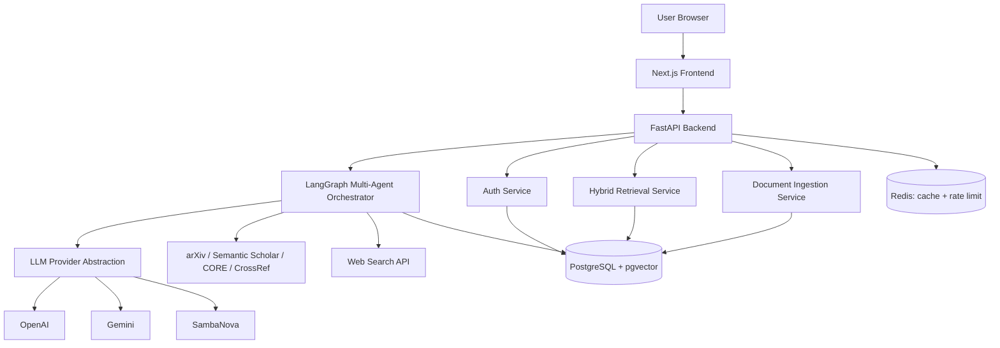
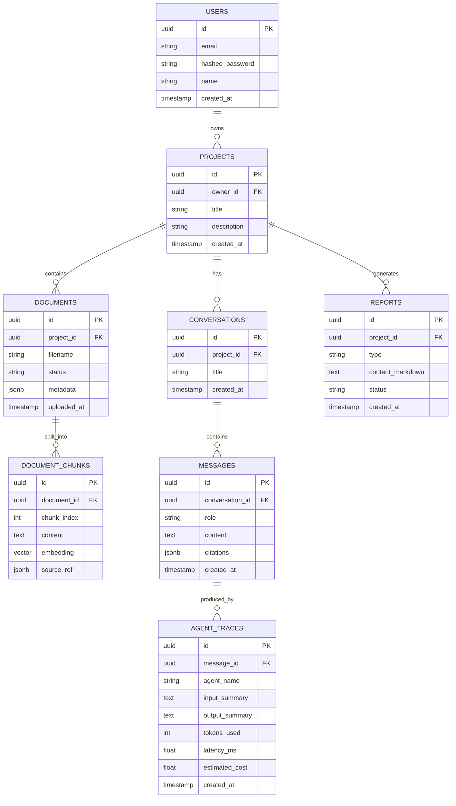

# Architecture & Specs — Aegis Research OS

## 1. System Architecture (high level)



## 2. Core Database Schema (starting point)



## 3. LLM Provider Abstraction (interface spec)

```python
from typing import Literal, Protocol
from pydantic import BaseModel

class Message(BaseModel):
    role: Literal["system", "user", "assistant"]
    content: str

class LLMResponse(BaseModel):
    text: str
    tokens_in: int
    tokens_out: int
    model_used: str
    estimated_cost_usd: float

class LLMProvider(Protocol):
    async def complete(
        self,
        messages: list[Message],
        model_tier: Literal["fast", "strong"],
        max_tokens: int,
        tools: list[dict] | None = None,
    ) -> LLMResponse: ...
```

Each concrete provider (OpenAIProvider, GeminiProvider, SambaNovaProvider) maps `model_tier` to an
actual model name in its own config, so swapping providers never touches agent/business logic.
Select the active provider via an environment variable (`LLM_PROVIDER=openai|gemini|sambanova`).

## 4. API Contract Conventions

- All responses use a consistent envelope:
```json
{ "success": true, "data": { ... }, "error": null }
```
- Errors:
```json
{ "success": false, "data": null, "error": { "code": "VALIDATION_ERROR", "message": "..." } }
```
- Pagination via `?page=&page_size=` with `data.items` + `data.total`.
- All authenticated endpoints require `Authorization: Bearer <token>`.

### Core endpoints (MVP)
| Method | Path | Purpose |
|---|---|---|
| POST | /auth/register | Create account |
| POST | /auth/login | Get access/refresh tokens |
| POST | /auth/refresh | Refresh access token |
| GET | /auth/me | Current user info |
| GET/POST | /projects | List / create projects |
| GET/DELETE | /projects/{id} | Get / delete a project |
| POST | /projects/{id}/documents | Upload a document |
| GET | /projects/{id}/documents | List documents + status |
| POST | /projects/{id}/query | Run hybrid RAG / agent query |
| GET | /projects/{id}/traces/{run_id} | Get agent reasoning trace |
| POST | /projects/{id}/reports | Generate a research artifact |
| GET | /projects/{id}/reports | List generated reports |
| GET | /projects/{id}/reports/{id}/export?format= | Export report |

## 5. Agent Roster (MVP — 7 core agents)

| Agent | Purpose | Tier | External calls |
|---|---|---|---|
| Supervisor/Planner | Decompose request, route subtasks | strong | — |
| Retrieval | Hybrid search + external academic/web search | fast | arXiv, Semantic Scholar, CORE, CrossRef, web search |
| Summarizer | Condense retrieved material | fast | — |
| Fact-Checker/Citation | Verify claims, normalize citations | fast | — |
| Synthesis/Report-Writer | Compose final answer/artifact | strong | — |
| Memory | Maintain project-level context | fast | — |
| Critic/Reviewer | Final QA pass, can loop back once | strong | — |

## 6. Non-Functional Targets (for the report's evaluation section)

- Query latency (simple RAG question): < 8s end-to-end
- Multi-agent research request: < 2 min end-to-end
- Retrieval precision\@5 on gold test set: report actual measured value
- Uptime during demo window: 100% (test this the day before your defense)
