# Aegis Research OS — System Design Document

> **Status:** Design baseline for implementation (v1.0)
> **Project type:** Solo-developer B.Tech major project
> **Scope model:** MVP-first (Phases 0–6), stretch scope gated behind an MVP checkpoint (Phases 7–10), testing/security/deployment continuous (Phase 11)
> **Source of truth:** `01_analysis_and_improvements.md`, `02_master_prompt.md`, `03_phase_prompts.md`, `04_architecture_and_specs.md`, `05_project_report_outline.md`

This document describes **what** Aegis Research OS is, **why** each part exists, and the boundaries and contracts between parts. It is intentionally not a line-by-line implementation guide: it specifies interfaces, data shapes, responsibilities, and acceptance-level behaviour so that an engineer can implement any single component without needing to re-derive the whole system.

---

## Table of Contents

1. [Project Overview](#1-project-overview)
2. [Product Requirements](#2-product-requirements)
3. [System Architecture](#3-system-architecture)
4. [AI Architecture](#4-ai-architecture)
5. [Frontend Design](#5-frontend-design)
6. [Backend Design](#6-backend-design)
7. [Database Design](#7-database-design)
8. [Search & Knowledge Architecture](#8-search--knowledge-architecture)
9. [Security Design](#9-security-design)
10. [Scalability](#10-scalability)
11. [Deployment Architecture](#11-deployment-architecture)
12. [Folder Structure](#12-folder-structure)
13. [Coding Standards](#13-coding-standards)
14. [UI/UX Principles](#14-uiux-principles)
15. [Future Enhancements](#15-future-enhancements)
16. [Risks & Mitigations](#16-risks--mitigations)
17. [Assumptions](#17-assumptions)

---

## 1. Project Overview

### 1.1 Vision

Aegis Research OS is an **autonomous multi-agent AI research assistant**. A researcher creates a workspace, uploads their source material, and asks research-grade questions in natural language. Behind that single input, a coordinated team of specialised agents plans the work, retrieves evidence from both the user's documents and the open academic web, verifies claims against those sources, and composes a cited research artifact — a literature review, gap analysis, source comparison, or full survey — that the user can export as PDF, DOCX, or LaTeX.

The vision is not "a chatbot over your PDFs." It is a **research operating system**: a persistent, project-scoped environment where evidence accumulates, prior findings inform later questions, and every generated sentence is traceable back to a retrieved source.

Three commitments define the product:

| Commitment | What it means in practice |
|---|---|
| **Grounded, never guessed** | Every claim in a generated artifact carries a citation to a chunk that was actually retrieved. A dedicated Fact-Checker agent and a Critic agent exist for the sole purpose of enforcing this. |
| **Transparent reasoning** | The user can open a Reasoning Trace panel and see, step by step, which agent ran, what it received, what it produced, how many tokens it used, and what it cost. Agent behaviour is never a black box. |
| **Shippable by one person** | Four moving infrastructure parts (PostgreSQL+pgvector, Redis, FastAPI, Next.js), seven agents rather than fifteen, one database rather than three. Operational simplicity is a first-class design constraint. |

### 1.2 Problem Statement

Manual literature review and research synthesis is slow, repetitive, and error-prone.

A researcher beginning work on an unfamiliar topic must:

1. **Discover** relevant prior work across fragmented sources — arXiv, Semantic Scholar, CORE, CrossRef, institutional repositories, and the general web — each with its own interface and coverage gaps.
2. **Read and extract** the methodology, findings, and limitations from dozens of PDFs, most of which turn out to be marginally relevant.
3. **Synthesise** those readings into a coherent narrative organised by theme rather than by paper.
4. **Identify gaps and contradictions** across sources — the actual intellectual contribution of a literature review, and the step most often rushed.
5. **Cite everything correctly**, tracing each claim back to a specific paper, page, and section.

This cycle consumes weeks. It scales badly: doubling the corpus more than doubles the synthesis effort, because the researcher must hold cross-source relationships in working memory.

Existing AI tools each solve a slice and leave the rest:

| System | What it does well | Gap Aegis addresses |
|---|---|---|
| **Perplexity** | Fast, cited web answers | Session-scoped; no persistent project corpus; not oriented to academic synthesis artifacts |
| **NotebookLM** | Strong grounding in user-uploaded documents | Closed corpus — cannot reach out to academic APIs for sources the user does not already have |
| **Elicit** | Structured literature-review workflows over a paper index | Limited orchestration over the user's own private documents; opaque intermediate reasoning |
| **OpenAI Deep Research** | Long-horizon autonomous research | Opaque process, no project-level memory the user controls, no exportable structured artifacts on the user's terms |

The common gap: **no single system combines a persistent private corpus, open academic retrieval, explicit multi-agent verification, and exportable research artifacts, with the reasoning process visible to the user.** That is the space Aegis Research OS occupies.

### 1.3 Target Users

**Primary — the postgraduate / final-year student researcher.**
Writing a thesis or major-project report. Has 20–100 PDFs of varying relevance, a topic that keeps shifting, and a hard deadline. Needs a literature review that is defensible under examination — which means every citation must be real and checkable. This user is also the person building the system, which keeps the feedback loop tight and the requirements honest.

**Secondary — the academic researcher or reviewer.**
Entering an adjacent field or evaluating a submission. Needs rapid, trustworthy orientation: what the major approaches are, how they differ, and where the open problems sit. Values the source comparison and gap detection artifacts most.

**Secondary — the R&D / technical analyst.**
Producing internal state-of-the-art briefs. Needs export fidelity (DOCX for circulation, PDF for archive) and an executive summary suitable for non-specialist stakeholders.

**Tertiary (stretch scope) — the small research team.**
Two to five people sharing a project workspace with owner/editor/viewer roles, an activity audit log, and a per-project API-cost dashboard. Enabled by Phase 10, not by the MVP.

**Non-users, explicitly.** This is not a general-purpose assistant, not a writing ghostwriter for unsourced prose, and not a plagiarism tool. The design deliberately refuses to produce uncited assertions.

### 1.4 Objectives

**Product objectives**

| ID | Objective | Delivered by |
|---|---|---|
| O1 | Persistent, project-scoped research workspaces with authenticated multi-user isolation | Phase 1 |
| O2 | Ingest PDF and DOCX documents into searchable, citable, embedded chunks | Phase 3 |
| O3 | Answer natural-language questions with hybrid (semantic + keyword) retrieval and inline citations | Phase 4 |
| O4 | Orchestrate 7 specialised agents to handle multi-part research requests beyond single-shot lookup | Phase 5 |
| O5 | Produce research artifacts: literature review, gap analysis, source comparison, survey | Phase 6 |
| O6 | Export any artifact to PDF, DOCX, and LaTeX with structure and citations preserved | Phase 9 |
| O7 | Expose the full agent reasoning trace, with token/latency/cost accounting, in the UI | Phase 5 |

**Engineering objectives**

| ID | Objective | Rationale |
|---|---|---|
| E1 | Single database for relational data *and* vectors (PostgreSQL + pgvector) | Removes ChromaDB; one backup story, one connection pool, one query language |
| E2 | All LLM traffic behind one `LLMProvider` interface | Provider swap (OpenAI ↔ Gemini ↔ SambaNova) never touches agent or route code |
| E3 | Mandatory `model_tier` and `max_tokens` on every LLM call | Cost control is enforced in code, not by discipline |
| E4 | Redis-backed response and external-API caching | Repeated work is the dominant avoidable cost |
| E5 | Tests shipped per phase, never deferred | A half-tested system at week 11 is unrecoverable for a solo developer |
| E6 | `docker compose up` runs the whole stack, every phase, with no undocumented steps | The demo must never depend on the author's laptop state |

**Academic objectives**

| ID | Objective |
|---|---|
| A1 | Every phase produces a `PHASE_LOG.md` entry, consolidated into `docs/build-history.md` |
| A2 | Measured evaluation against a gold-standard test set, not qualitative claims |
| A3 | Design artifacts (architecture, ERD, agent interaction, API contract, UML) authored as project deliverables, mapped to the report outline in `05_project_report_outline.md` |

### 1.5 Success Metrics

Metrics are split into *product quality*, *performance*, and *delivery*. Performance targets are the non-functional targets from `04_architecture_and_specs.md`.

**Product quality**

| Metric | Target | How measured |
|---|---|---|
| Citation validity (no hallucinated citations) | **100%** — every citation resolves to a chunk actually present in the retrieval set for that run | Automated check comparing artifact citation IDs against the run's retrieved-chunk IDs |
| Retrieval precision@5 | Measured and reported on the gold-standard set (5–10 curated Q&A pairs) | Manual relevance labelling against the gold set |
| Critic agent efficacy | Catches and flags a deliberately injected unsupported claim in the test case | Phase 5 acceptance test |
| Artifact coherence | Literature review over 5+ documents is coherent, thematically organised, and correctly cited | Rubric review against the gold corpus |
| Graceful failure | Corrupt/unsupported upload yields a clear error state, never a crash or silent garbage text | Phase 3 acceptance test |

**Performance**

| Metric | Target |
|---|---|
| Simple RAG question, end-to-end | **< 8 s** |
| Multi-agent research request, end-to-end | **< 2 min** |
| Literature review generation (5+ documents) | **< 2 min** |
| Uptime during the demo window | **100%** (rehearsed the day before defence) |
| External API response time (arXiv, Semantic Scholar, CORE) | **< 5 s** 95th percentile |
| External API availability | **> 95%** during normal operation |
| Cost per query | Tracked per query type; caching impact quantified for the report's cost-analysis section |

**Delivery**

| Metric | Target |
|---|---|
| MVP checkpoint (Phases 0–6 complete, demoable end-to-end) | ~10.5 weeks |
| Full scope including stretch phases | ~16 weeks |
| Cold-start reproducibility | Fresh clone + README only → running app via `docker compose up`, zero undocumented steps |
| Per-phase discipline | Every phase ends with code + `PHASE_LOG.md` entry + updated `.env.example`/README + tests |

---

## 2. Product Requirements

### 2.1 Core Features

Features are labelled **MVP** (Phases 0–6, must ship) or **Stretch** (Phases 7–10, gated behind the MVP checkpoint).

| # | Feature | Scope | Phase | Description |
|---|---|---|---|---|
| F1 | Accounts & authentication | MVP | 1 | Register, log in, refresh, current-user. JWT access + refresh, bcrypt password hashing. |
| F2 | Research workspaces (projects) | MVP | 1 | Create, list, open, delete a project. Every document, conversation, artifact, and trace is scoped to a project. |
| F3 | Document ingestion | MVP | 3 | Drag-and-drop upload of PDF/DOCX. Text extraction, OCR fallback for scanned PDFs, metadata extraction, token-aware chunking, embedding generation. Async with pollable status. |
| F4 | Hybrid RAG question answering | MVP | 4 | Semantic (pgvector) + keyword (Postgres FTS) retrieval, fused by reciprocal rank fusion, optional cross-encoder re-ranking, metadata filtering, cited answer generation. |
| F5 | Multi-agent research pipeline | MVP | 5 | LangGraph orchestration of 7 agents for multi-part research requests. External academic and web retrieval. Full trace logging. |
| F6 | Reasoning Trace panel | MVP | 5 | Collapsible UI panel showing the live agent sequence for the current run, with tokens, latency, and cost per step. |
| F7 | Literature review generation | MVP | 6 | Structured Markdown: introduction, thematic sections, synthesis, gaps, references. |
| F8 | Research gap detection | MVP | 6 | Explicit list of gaps and contradictions across retrieved sources, each with supporting citations. |
| F9 | Paper/source comparison | MVP | 6 | Structured table comparing 2+ sources on methodology, findings, limitations. |
| F10 | Survey generation | MVP | 6 | Longer-form multi-section survey combining review + comparison + gap analysis. |
| F11 | Project memory | MVP | 5 | Project-level long-term context (past queries, established facts) so later questions build on earlier ones. |
| F12 | Report export | MVP core / polish in 9 | 6, 9 | Markdown as source of truth → PDF, DOCX, LaTeX. Executive summary generator. Reports tab with re-export. |
| F13 | Trend analysis & hypothesis generation | Stretch-within-6 | 6 | Additional agent-driven outputs; explicitly non-blocking for the MVP checkpoint. |
| F14 | Knowledge graph | Stretch | 7 | Entity/relationship extraction (authors, topics, institutions, citations) with interactive graph visualisation. Modelled relationally in PostgreSQL. |
| F15 | Dataset analytics | Stretch | 8 | CSV upload, pandas profiling, sandboxed AI-generated analysis code, chart generation, plain-language explanation. |
| F16 | Team collaboration | Stretch | 10 | Project invitations with owner/editor/viewer roles, activity audit log, completion notifications, per-project cost/usage dashboard. |

**Explicit non-features for the MVP.** ChromaDB, Neo4j, and Celery are excluded by design — pgvector replaces the first, relational graph modelling defers the second, and FastAPI `BackgroundTasks` (with `arq` as the upgrade path) replaces the third. Any UI surface for an unbuilt feature (Knowledge Graph, Reports before Phase 6) must render a clearly labelled "coming soon" placeholder, never fabricated data.

### 2.2 User Roles

**MVP roles**

| Role | Capabilities |
|---|---|
| **Anonymous visitor** | View the landing page, register, log in. No access to any project data. |
| **Authenticated user** | Full ownership of their own projects: create/delete projects, upload/delete documents, run queries and agent pipelines, generate and export artifacts, view their own traces. Cannot see any other user's data. |

**Stretch roles (Phase 10, per-project membership)**

| Role | Documents | Queries & generation | Members | Project settings |
|---|---|---|---|---|
| **Owner** | Upload, delete | Yes | Invite, remove, change roles | Edit, delete project |
| **Editor** | Upload, delete | Yes | View members | View only |
| **Viewer** | View only | View existing results; **cannot** run generation | View members | View only |

Role enforcement is server-side on every project-scoped route. The frontend hides unavailable actions, but hiding is a UX affordance, never the security boundary. The Phase 10 acceptance criterion is explicit: an invited viewer must be blocked from uploading or deleting documents.

### 2.3 Functional Requirements

Requirements are traceable: each maps to a feature and a phase.

#### FR-A — Authentication & Accounts (F1, Phase 1)

| ID | Requirement |
|---|---|
| FR-A1 | A visitor can register with email, password, and name. Email must be unique; duplicates return a validation error. |
| FR-A2 | Passwords are hashed with bcrypt. Plaintext passwords are never stored or logged. |
| FR-A3 | Login returns a short-lived access token and a longer-lived refresh token. |
| FR-A4 | `POST /auth/refresh` exchanges a valid refresh token for a new access token. |
| FR-A5 | `GET /auth/me` returns the authenticated user's profile. |
| FR-A6 | All non-auth endpoints require `Authorization: Bearer <token>`; absence or invalidity returns 401. |

#### FR-B — Projects (F2, Phase 1)

| ID | Requirement |
|---|---|
| FR-B1 | An authenticated user can create a project with a title and optional description. |
| FR-B2 | `GET /projects` lists only projects the caller may access. |
| FR-B3 | `GET /projects/{id}` returns project detail; access by a non-member returns 404 (not 403 — resource existence is not disclosed). |
| FR-B4 | Deleting a project cascades to its documents, chunks, conversations, messages, traces, and reports. |

#### FR-C — Document Intelligence (F3, Phase 3)

| ID | Requirement |
|---|---|
| FR-C1 | Multipart upload to `POST /projects/{id}/documents` accepts PDF and DOCX. Other types are rejected with a clear error. |
| FR-C2 | Upload returns immediately with a document record in `pending`; processing runs in the background. |
| FR-C3 | Text extraction: PDF via `pypdf`/`pdfplumber`, DOCX via `python-docx`. |
| FR-C4 | Scanned PDFs fall back to OCR (`pytesseract`). If OCR confidence is low, the document is **flagged** — the system must not silently store garbage text. |
| FR-C5 | Best-effort metadata extraction: title, authors, page count, upload date, stored in `documents.metadata` (JSONB). |
| FR-C6 | Token-aware chunking at ~500–800 tokens with overlap, preserving page/section reference in `document_chunks.source_ref` for later citation. |
| FR-C7 | Each chunk is embedded with a sentence-transformers model and stored in the pgvector column. |
| FR-C8 | `GET /documents/{id}` reports status: `pending` → `processing` → `ready` \| `failed`. |
| FR-C9 | Failed extraction (e.g. corrupt file) produces a `failed` status with a human-readable reason. No crash. |
| FR-C10 | A user can view extracted metadata and delete a document; deletion removes its chunks. |

#### FR-D — Hybrid RAG (F4, Phase 4)

| ID | Requirement |
|---|---|
| FR-D1 | Semantic search: cosine-similarity search over pgvector embeddings, **scoped to the project**. |
| FR-D2 | Keyword search: PostgreSQL full-text search (`tsvector`/`tsquery`) over chunk text. |
| FR-D3 | Results from FR-D1 and FR-D2 are fused via reciprocal rank fusion. |
| FR-D4 | An optional cross-encoder re-ranking pass refines the fused top-K before context assembly. |
| FR-D5 | Metadata filters supported: specific document(s), date range, section. |
| FR-D6 | Answer generation uses the `strong` tier via `LLMProvider`, receives top-N chunks as context, and must cite sources inline (e.g. `[Doc 2, p.4]`). |
| FR-D7 | The response returns both answer text and a structured list of the source chunks used. |
| FR-D8 | Each Q&A is persisted as conversation messages with citations. |
| FR-D9 | Generated answers cite **only** chunks present in that run's retrieval set. Verified by test. |

#### FR-E — Multi-Agent System (F5, F6, F11, Phase 5)

| ID | Requirement |
|---|---|
| FR-E1 | Seven agents are implemented as LangGraph nodes: Supervisor/Planner, Retrieval, Summarizer, Fact-Checker/Citation, Synthesis/Report-Writer, Memory, Critic/Reviewer. |
| FR-E2 | The Supervisor decomposes a research request into subtasks and routes them. |
| FR-E3 | The Retrieval agent performs Phase-4 hybrid search and, when the request needs sources beyond the uploaded corpus, calls arXiv, Semantic Scholar, CORE, and CrossRef, plus a web search API. |
| FR-E4 | The Critic may return the task to an earlier agent **once**; it cannot loop indefinitely. |
| FR-E5 | Every agent call passes through `LLMProvider` with an explicit `model_tier` and `max_tokens`. |
| FR-E6 | Every agent invocation is logged to `agent_traces`: agent name, input summary, output summary, tokens, latency, estimated cost. |
| FR-E7 | `GET /projects/{id}/traces/{run_id}` returns the ordered trace for a run. |
| FR-E8 | The frontend renders a collapsible Reasoning Trace panel showing the live agent sequence. |
| FR-E9 | Deterministic sub-steps (notably repeated external API calls for the same query) are cached in Redis. |
| FR-E10 | The Memory agent persists project-level context so repeated or follow-up questions build on prior findings. |
| FR-E11 | A multi-part request (e.g. "compare approach A and B and identify open gaps") visibly triggers multiple agents in the trace and cites both uploaded documents and external academic sources. |

#### FR-F — Research Intelligence (F7–F10, F13, Phase 6)

| ID | Requirement |
|---|---|
| FR-F1 | Literature review generation returns structured Markdown: introduction, thematic sections, synthesis, gaps, references. |
| FR-F2 | Gap detection returns an explicit list of gaps/contradictions, each with supporting citations. |
| FR-F3 | Comparison of 2+ sources returns a structured table over methodology, findings, limitations. |
| FR-F4 | Survey generation returns a longer-form multi-section document combining review, comparison, and gap analysis. |
| FR-F5 | A "Generate" panel lets the user pick the artifact type, watch progress via the trace panel, and read the rendered Markdown with clickable citations. |
| FR-F6 | Trend analysis and hypothesis generation are optional within this phase and must not block the MVP checkpoint. |

#### FR-G — Reports & Export (F12, Phases 6 & 9)

| ID | Requirement |
|---|---|
| FR-G1 | Markdown is the single source of truth for every artifact; all exports derive from it. |
| FR-G2 | PDF export via a Markdown→PDF pipeline (WeasyPrint or headless-browser print-to-PDF). |
| FR-G3 | DOCX export via `python-docx`, mapping Markdown headings, lists, and tables to Word styles. |
| FR-G4 | LaTeX export via template-based conversion (pandoc acceptable) producing a compilable `.tex`. |
| FR-G5 | An executive summary generator condenses a full report to roughly one page. |
| FR-G6 | A Reports tab lists all artifacts per project with re-export options. |
| FR-G7 | Every export opens correctly in its native viewer with headings, citations, and tables preserved. |

#### FR-H — Stretch requirements (Phases 7, 8, 10)

| ID | Requirement |
|---|---|
| FR-H1 | Entity extraction during ingestion and from retrieval results populates relational node/edge tables (authors, topics, institutions; co-authorship, citation, topic-membership edges). |
| FR-H2 | An interactive graph view (react-flow or cytoscape.js) supports node-type filtering and click-to-inspect linking back to source documents. |
| FR-H3 | CSV upload produces pandas-based profiling (column types, summary statistics). |
| FR-H4 | AI-generated analysis code executes in a **sandboxed, resource-limited** environment. Filesystem access attempts and runaway loops are contained or rejected. |
| FR-H5 | Charts are returned as images or interactive chart configs with a plain-language explanation. |
| FR-H6 | Project membership with owner/editor/viewer roles, enforced server-side. |
| FR-H7 | An activity audit log records uploads, queries, and generations per project. |
| FR-H8 | In-app notification fires when a long-running generation completes. |
| FR-H9 | A per-project usage dashboard (tokens, estimated cost, query count) is derived from `agent_traces`. |

### 2.4 Non-Functional Requirements

#### Performance

| ID | Requirement |
|---|---|
| NFR-P1 | Simple RAG question: **< 8 s** end-to-end. |
| NFR-P2 | Multi-agent research request: **< 2 min** end-to-end. |
| NFR-P3 | Literature review over 5+ documents: **< 2 min**. |
| NFR-P4 | Document upload returns within ~1 s; heavy processing is asynchronous. |
| NFR-P5 | Answers stream (or progressively render) so long agent chains feel responsive rather than frozen. |
| NFR-P6 | The query endpoint is load-tested under a realistic concurrent-user scenario, with results recorded for the report. |

#### Reliability & Availability

| ID | Requirement |
|---|---|
| NFR-R1 | 100% uptime during the demo window, rehearsed the day before defence. |
| NFR-R2 | Per-service health-check endpoints. |
| NFR-R3 | A failure in any single agent degrades the run gracefully with a partial result and a clear error — it does not lose the whole run silently. |
| NFR-R4 | External API failures (arXiv, Semantic Scholar, CORE, CrossRef, web search) are non-fatal; the pipeline continues on the remaining sources. |
| NFR-R5 | Ingestion failures are isolated per document; one bad file cannot block a project's queue. |

#### Cost & Efficiency

| ID | Requirement |
|---|---|
| NFR-C1 | Tiered routing is mandatory: `fast` for retrieval, ranking, and summarisation; `strong` only for planning, synthesis, and final review. |
| NFR-C2 | Every agent call declares a `max_tokens` budget, enforced in code. |
| NFR-C3 | LLM responses are cached in Redis keyed by a hash of (prompt, model_tier, relevant document IDs). |
| NFR-C4 | Token counts and estimated cost are logged per call for the report's cost analysis. |

#### Security

| ID | Requirement |
|---|---|
| NFR-S1 | Project data is isolated per user (per member in Phase 10). No cross-tenant read path exists. |
| NFR-S2 | Upload validation: MIME/extension allow-list and a maximum file size. |
| NFR-S3 | Redis-backed rate limiting on auth and query endpoints. |
| NFR-S4 | Secrets only via environment variables; `.env` is gitignored and never committed. |
| NFR-S5 | Dependency vulnerability scanning (`pip-audit`, `npm audit`) with findings resolved or documented. |
| NFR-S6 | Sandboxing review of the Phase 8 code-execution feature, if built. |

#### Usability & Accessibility

| ID | Requirement |
|---|---|
| NFR-U1 | Responsive layout from desktop down to mobile width. |
| NFR-U2 | Dark and light themes both look intentional — not a mechanical colour inversion — with the preference persisted. |
| NFR-U3 | No layout shift or broken state across empty, loading, and populated data states. |
| NFR-U4 | Loading skeletons for async content; toast notifications for success and error. |
| NFR-U5 | WCAG 2.1 AA as the working target: keyboard navigability, visible focus states, adequate contrast, and screen-reader labelling. Full conformance requires manual assistive-technology testing and expert review, which is out of scope for this project. |

#### Maintainability & Observability

| ID | Requirement |
|---|---|
| NFR-M1 | No agent or route code calls a provider SDK directly — always via `LLMProvider`. |
| NFR-M2 | Structured logs with correlation IDs across request → agent run → agent step. |
| NFR-M3 | Each phase ships unit tests for its backend logic plus at least one integration test for its primary user flow. |
| NFR-M4 | All schema changes go through Alembic migrations. |
| NFR-M5 | A fresh clone following only the README yields a running app via `docker compose up`. |

---

## 3. System Architecture

### 3.1 Architectural Style

A **modular monolith with an agentic core**. Two deployable application services (Next.js frontend, FastAPI backend) plus two infrastructure services (PostgreSQL with pgvector, Redis). Inside the backend, boundaries are enforced by module structure and service interfaces rather than by network hops.

This is a deliberate choice grounded in the source analysis: five infrastructure services for a solo developer is high operational overhead with no compensating benefit at this scale. The layering is strict enough that any service could be extracted later — the ingestion pipeline and the agent orchestrator are the natural first candidates — but nothing is distributed before it needs to be.

### 3.2 High-Level Architecture

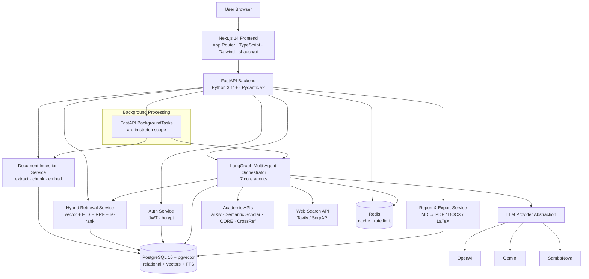

### 3.3 Major Components & Responsibilities

#### Next.js Frontend

**Owns:** all presentation, client-side routing, auth session handling, optimistic UI, streaming render of answers and traces.
**Does not own:** any business logic, retrieval logic, or direct database/LLM access.

| Responsibility | Detail |
|---|---|
| Route protection | Redirect unauthenticated users away from `/dashboard` and `/projects/*` |
| Session management | Hold and refresh tokens; attach `Authorization` on every API call |
| Progressive rendering | Stream answer tokens and poll/stream trace steps so long runs stay legible |
| Placeholder honesty | Render explicit "coming soon" states for unbuilt features |

#### FastAPI Backend — API Layer (`app/api`)

**Owns:** HTTP surface, request/response validation, the uniform JSON envelope, auth dependency injection, project-scope authorisation, background-task dispatch, error→HTTP mapping.
**Does not own:** business logic. Routers are thin; they validate, authorise, delegate to a service, and shape the response.

#### Auth Service (`app/core/security`, `app/services/auth`)

Registration, credential verification, bcrypt hashing, access/refresh token issuance and validation, current-user resolution. Single source of truth for identity.

#### Document Ingestion Service (`app/services/ingestion`)

The pipeline from uploaded bytes to embedded, citable chunks: file validation → text extraction (with OCR fallback) → metadata extraction → token-aware chunking with page/section provenance → embedding → persistence → status transitions. Owns the `pending/processing/ready/failed` lifecycle and all extraction-failure handling.

#### Hybrid Retrieval Service (`app/services/retrieval`)

Project-scoped semantic search over pgvector, keyword search over Postgres FTS, reciprocal rank fusion, optional cross-encoder re-ranking, metadata filtering, and context assembly with citation references attached. Used directly by the Phase 4 query path and as a tool by the Retrieval agent in Phase 5.

#### LangGraph Multi-Agent Orchestrator (`app/agents`)

Defines the agent graph, shared run state, routing and conditional edges, the Critic's single retry edge, per-agent token budgets and tiers, and trace emission. Owns run lifecycle and cancellation. Every LLM call goes through `LLMProvider`; no provider SDK appears here.

#### LLM Provider Abstraction (`app/core/llm`)

One `complete()` interface, three concrete implementations, `model_tier` → concrete-model mapping held in provider config, token accounting, cost estimation, retry/backoff, and Redis response caching. The active provider is selected by the `LLM_PROVIDER` environment variable.

#### External Source Connectors (`app/services/external`)

Uniform client wrappers for arXiv, Semantic Scholar, CORE, CrossRef, and the web search provider. Each normalises heterogeneous responses into a common `ExternalSource` shape, applies Redis caching keyed by normalised query, and fails soft.

#### Report & Export Service (`app/services/reports`)

Artifact persistence (Markdown as source of truth), export rendering to PDF/DOCX/LaTeX, executive summary generation, and citation-integrity validation before an artifact is marked complete.

#### PostgreSQL 16 + pgvector

Single store for users, projects, documents, chunks **and their embeddings**, conversations, messages, agent traces, reports, and (stretch) graph nodes/edges, memberships, activity log, datasets.

#### Redis

LLM response cache, external API cache, rate-limit counters, and lightweight run-status/pubsub for streaming trace updates.

#### Background Processing

FastAPI `BackgroundTasks` for the MVP; `arq` (or Celery) only if stretch scope demands durable queues. Handles ingestion and long agent runs so HTTP requests never block on them.

### 3.4 Communication Between Components

| From → To | Mechanism | Notes |
|---|---|---|
| Browser → Frontend | HTTPS | Next.js App Router, server and client components |
| Frontend → Backend | REST/JSON over HTTPS | Uniform envelope; `Authorization: Bearer` on protected routes |
| Frontend ← Backend (answers) | Streaming response (SSE / chunked) | Progressive answer rendering |
| Frontend ← Backend (traces) | SSE stream `GET /projects/{id}/traces/{run_id}/stream` | Consistent with answer streaming; provides real-time trace updates |
| Backend → Services | In-process function calls | Typed service interfaces, Pydantic models at boundaries |
| Orchestrator → Agents | LangGraph state transitions | Shared `AgentRunState`; nodes are pure-ish functions over state |
| Agents → LLM | `await provider.complete(...)` | Cache-checked, tier-tagged, budget-bounded |
| Agents → External APIs | Async HTTP via connectors | Cached, rate-limited, fail-soft |
| Backend → PostgreSQL | SQLAlchemy 2.0 async ORM | Alembic-managed schema |
| Backend → Redis | Async Redis client | Cache, rate limits, run status |
| API → Background tasks | `BackgroundTasks.add_task` | Status observable via DB, progress via traces |

### 3.5 End-to-End Request Flow

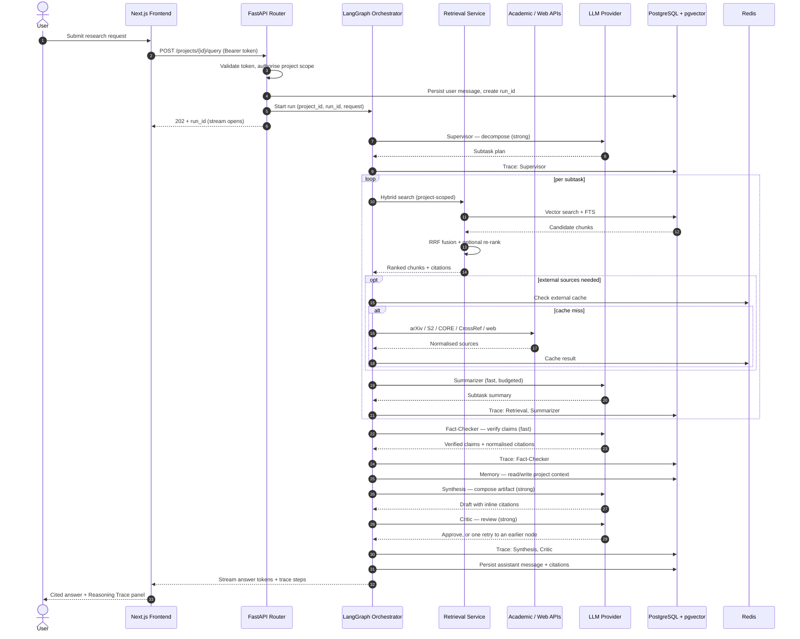

---

## 4. AI Architecture

The AI subsystem is layered so each layer has one job and can be tested in isolation: **provider layer** (talk to models), **embedding layer** (turn text into vectors), **retrieval layer** (find evidence), **memory layer** (remember across turns), **orchestration layer** (coordinate agents), and **context layer** (fit everything in the window without losing citations).

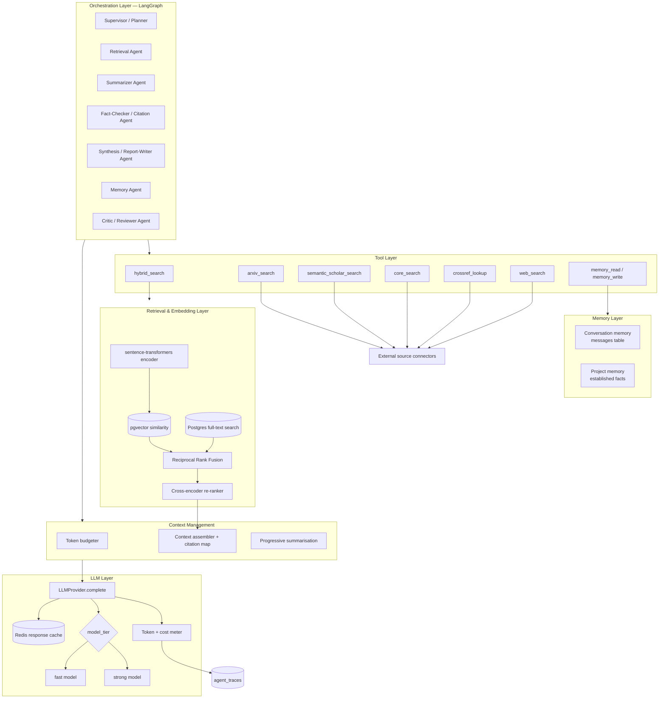

### 4.1 LLM Layer

**Principle:** all LLM traffic passes through exactly one interface. No agent, service, or router imports a provider SDK.

```python
from typing import Literal, Protocol
from pydantic import BaseModel

class Message(BaseModel):
    role: Literal["system", "user", "assistant"]
    content: str

class LLMResponse(BaseModel):
    text: str
    tokens_in: int
    tokens_out: int
    model_used: str
    estimated_cost_usd: float

class LLMProvider(Protocol):
    async def complete(
        self,
        messages: list[Message],
        model_tier: Literal["fast", "strong"],
        max_tokens: int,
        tools: list[dict] | None = None,
    ) -> LLMResponse: ...
```

**Concrete implementations:** `OpenAIProvider`, `GeminiProvider`, `SambaNovaProvider`. Each maps `model_tier` to a real model name in its own configuration, so switching providers never touches agent or business logic. The active provider is chosen by `LLM_PROVIDER=openai|gemini|sambanova`.

**Tier policy.** `model_tier` is a required argument, not a default, because cost discipline is enforced at the type level:

| Tier | Used for | Agents |
|---|---|---|
| `fast` | High-volume, low-judgement work: ranking, condensation, verification, context maintenance | Retrieval, Summarizer, Fact-Checker/Citation, Memory |
| `strong` | Low-volume, high-judgement work: planning, composition, final review | Supervisor/Planner, Synthesis/Report-Writer, Critic/Reviewer |

**Cross-cutting responsibilities the provider layer owns:**

- **Caching.** Before any network call, look up Redis with `sha256(prompt + model_tier + sorted(relevant_doc_ids))`. Cache hits are recorded in the trace as zero-cost steps, which makes caching impact measurable for the report.
- **Metering.** Return `tokens_in`, `tokens_out`, `model_used`, and `estimated_cost_usd` on every call. The orchestrator writes these into `agent_traces`.
- **Budget enforcement.** `max_tokens` is required. If assembled context would exceed the model window, the context layer compresses before the call rather than letting the provider truncate arbitrarily.
- **Resilience.** Bounded retry with exponential backoff on transient errors; a clear typed error on hard failures so the orchestrator can degrade the run rather than crash it. **Circuit breaker pattern** prevents cascading failures when LLM providers are down, with automatic failover between OpenAI/Gemini/SambaNova.

### 4.2 RAG Pipeline

Two retrieval paths share one pipeline.

- **Phase 4 — single-shot RAG.** One question → hybrid retrieval → cited answer. This is the fast path and remains available after Phase 5; a simple factual lookup should not pay the cost of a full agent graph.
- **Phase 5+ — agentic RAG.** A research request is decomposed into subtasks, each of which runs its own retrieval (internal and optionally external), and the results are summarised, verified, synthesised, and reviewed.

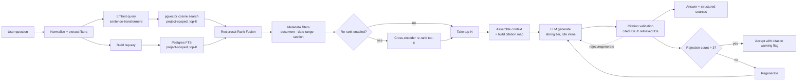

The **citation validation** gate is the pipeline's non-negotiable step. Every citation the model emits is resolved against the set of chunk IDs actually retrieved for that run. Unresolvable citations trigger regeneration, but after 3 attempts the system accepts the answer with a warning flag rather than entering an infinite loop. This makes the 100%-citation-validity metric enforceable while maintaining system availability.

### 4.3 Embedding System

| Aspect | Design |
|---|---|
| Model | `sentence-transformers` — `all-MiniLM-L6-v2` as the baseline, with a stronger multilingual model as a configurable upgrade |
| Where it runs | In-process in the backend container. No external embedding API call, so ingestion cost is CPU time, not API spend |
| What is embedded | Each `document_chunks.content` at ingestion time; each incoming query at retrieval time — the same model for both, always |
| Storage | pgvector column on `document_chunks` |
| Dimensionality | Fixed by the chosen model and recorded in configuration; the column type pins it |
| Batching | Chunks are embedded in batches during background ingestion to amortise model overhead |
| Model changes | Changing the embedding model invalidates all stored vectors. Treated as a migration: the model identifier is stored so a mismatch is detectable, and a re-embed script exists in `scripts/` |
| Determinism | Same text + same model → same vector, which makes ingestion idempotent and safely re-runnable |

### 4.4 Vector Database

**pgvector inside PostgreSQL 16 — not a separate vector store.** The rationale, taken directly from the improvements analysis: one database instead of two removes an entire operational surface for a solo developer, while still supporting hybrid semantic + metadata search.

What this buys:

- **Joins, not two-phase lookups.** Vector similarity, chunk text, document metadata, and project ownership are all in one query. There is no "search the vector DB, then hydrate from Postgres" round trip, and no risk of the two drifting out of sync.
- **One transaction.** Ingesting a document writes chunks and vectors atomically. A failed ingestion leaves no orphaned vectors.
- **One backup and restore story.** Critical when the demo environment must be reproducible on short notice.
- **Metadata filtering for free.** `WHERE project_id = ...`, date ranges, and document filters are plain SQL predicates composed with the similarity ordering.
- **Full-text search in the same engine.** The keyword half of hybrid retrieval is `tsvector`/`tsquery` on the same table — no second system to keep consistent.

Indexing and query strategy are detailed in [§7.4](#74-indexing-strategy).

### 4.5 Memory System

Memory has three horizons. Each has a different lifetime, store, and cost profile.

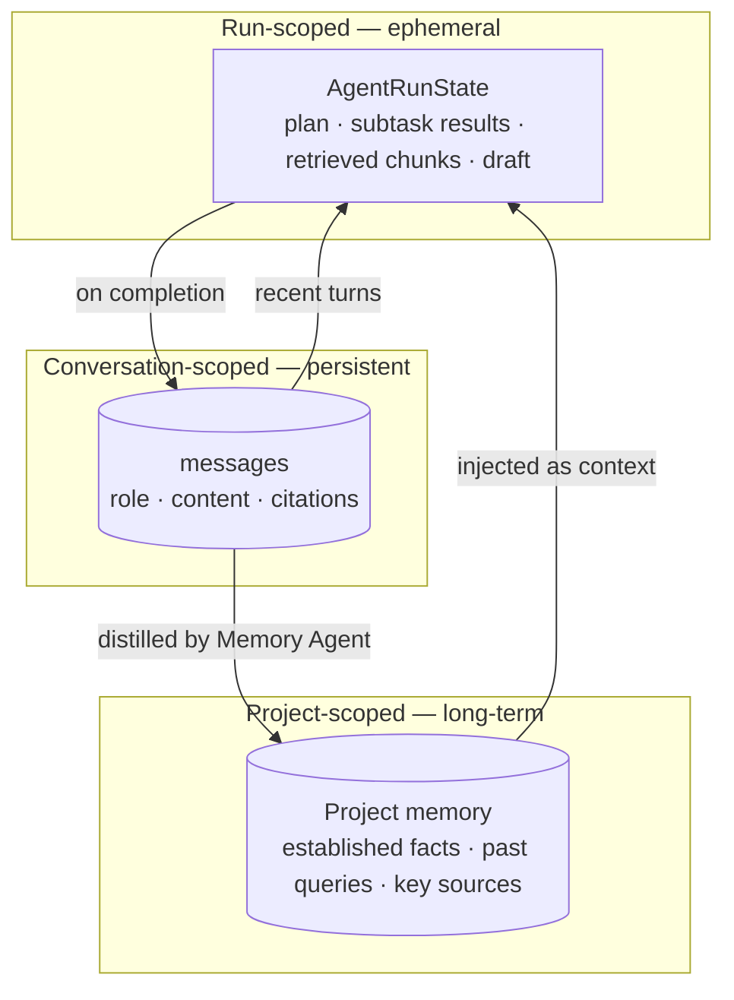

| Horizon | Lifetime | Store | Purpose |
|---|---|---|---|
| **Run** | One agent run | In-memory LangGraph `AgentRunState` | Plan, per-subtask retrievals and summaries, verified claims, draft artifact. Discarded after persistence. |
| **Conversation** | Life of the conversation | `messages` table | Chat history with citations. Recent turns are injected for follow-up resolution ("compare that with…"). |
| **Project** | Life of the project | Project memory records, written by the Memory agent | Established facts, prior queries, recurring key sources. This is what makes the workspace an accumulating asset: a repeated or adjacent question builds on prior findings rather than starting cold. |

**Memory agent contract.** Runs on the `fast` tier. On read, it returns a compact, relevance-filtered digest of project memory for the current request — never a raw dump, which would blow the context budget. On write, it distils only durable, source-backed conclusions; speculative or unverified statements are not promoted to project memory. Established facts retain their citations, so a fact recalled from memory is still traceable to a document.

### 4.6 Agent Orchestration

Seven core agents, consolidated from an original fifteen because many overlapped (Fact Checker / Critic / Reviewer were near-duplicates). Four more are defined as optional stretch additions.

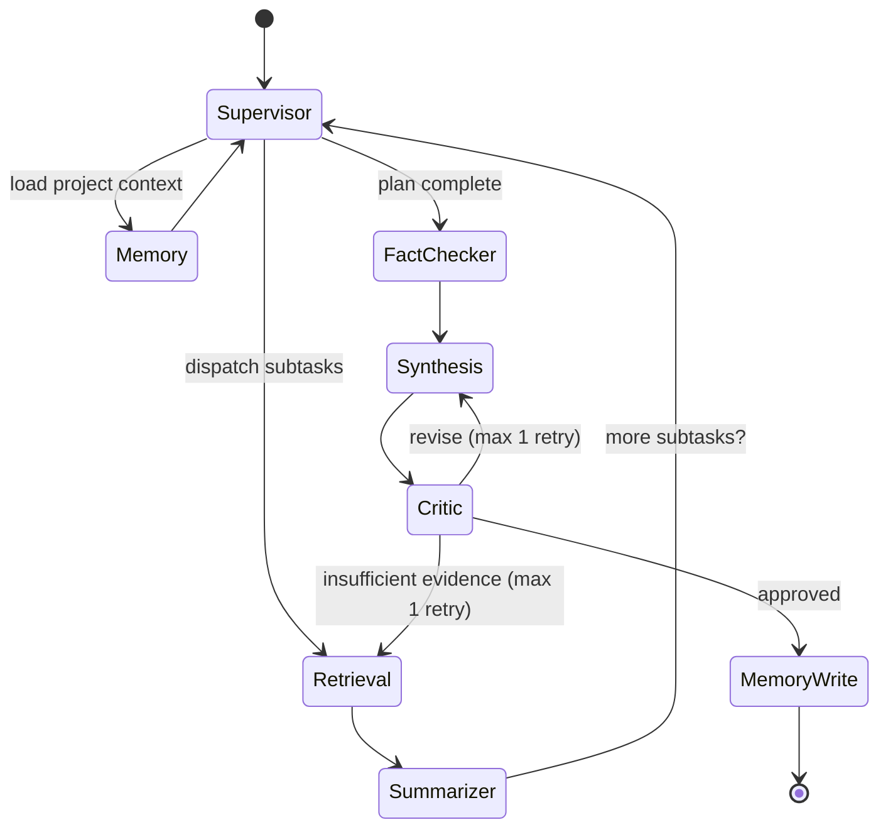

**Core roster (MVP)**

| Agent | Purpose | Tier | Tools / external calls |
|---|---|---|---|
| **Supervisor / Planner** | Decompose the request into subtasks, route them, decide when the plan is satisfied | `strong` | — |
| **Retrieval** | Hybrid search over project documents, plus external academic and web search when the request needs sources beyond the corpus | `fast` | `hybrid_search`, arXiv, Semantic Scholar, CORE, CrossRef, web search |
| **Summarizer** | Condense retrieved material per subtask | `fast` | — |
| **Fact-Checker / Citation** | Verify claims against retrieved sources; normalise citations to a consistent form | `fast` | — |
| **Synthesis / Report-Writer** | Compose the final answer or artifact from verified material | `strong` | — |
| **Memory** | Maintain and retrieve project-level long-term context | `fast` | `memory_read`, `memory_write` |
| **Critic / Reviewer** | Final QA for coherence, unsupported claims, completeness; may loop back **once** | `strong` | — |

**Optional roster (stretch, only after the MVP checkpoint):** Dataset/Code Search, Debate, Trend/Gap-Analysis, Hypothesis-Generation.

**Orchestration rules**

1. **Shared state, not message passing.** Every node reads and writes a typed `AgentRunState`. State is the contract between agents, which makes each node independently testable with a constructed state fixture.
2. **Bounded loops.** The Critic's retry edge fires at most once per run. The cap lives in the state (`retry_count`), not in a prompt, so a misbehaving model cannot cause an unbounded cost spiral.
3. **Trace-on-every-node.** Each node emits an `agent_traces` row before yielding: agent name, input summary, output summary, tokens, latency, estimated cost. This is simultaneously the debugger, the demo feature, and the data source for the cost-analysis section of the report.
4. **Explicit tier and budget per node.** Declared in the node definition, not chosen at call time.
5. **Graceful degradation.** A failed node marks itself failed in the trace and hands partial state onward when the remaining pipeline can still produce something useful; the user sees a partial result with a clear notice rather than an opaque error.
6. **Parallel subtasks where safe.** Independent retrieval and summarisation subtasks may run concurrently; synthesis is always a join point.

### 4.7 Tool Calling

Tools are the agents' only route to the outside world. Each is a typed async function with a Pydantic input schema, registered in a tool registry and exposed to the LLM through the `tools` parameter of `LLMProvider.complete`.

| Tool | Input | Returns | Cache |
|---|---|---|---|
| `hybrid_search` | query, project_id, filters, top_n | Ranked chunks with `source_ref` | Not cached (cheap, local) |
| `arxiv_search` | query, max_results | Normalised `ExternalSource[]` | Redis, keyed on normalised query |
| `semantic_scholar_search` | query, max_results | Normalised `ExternalSource[]` | Redis |
| `core_search` | query, max_results | Normalised `ExternalSource[]` | Redis |
| `crossref_lookup` | DOI or title | Canonical citation metadata | Redis |
| `web_search` | query | Normalised `ExternalSource[]` (Tavily/SerpAPI) | Redis |
| `memory_read` / `memory_write` | project_id, query / fact + citations | Context digest / ack | Not cached |

**Rules for tools**

- **Normalised output.** Every source connector returns the same `ExternalSource` shape (title, authors, year, venue, identifier/DOI, URL, abstract, provider). Agents never see provider-specific JSON.
- **Fail soft.** A dead or rate-limited external API returns an empty result plus a warning recorded in the trace. The run continues on the remaining sources.
- **Cached by default.** Repeated external calls for the same query are the most wasteful pattern in a multi-agent system; Redis caching of deterministic sub-steps is a stated requirement.
- **Validated arguments.** Tool arguments produced by the model are Pydantic-validated before execution. Invalid arguments produce a typed error returned to the agent for correction, never an unguarded call.
- **Provenance preserved.** Every tool result carries the identifiers needed to build a citation. A result that cannot be cited is not usable as evidence.

### 4.8 Context Management

Context is a budget, managed explicitly rather than hoped about.

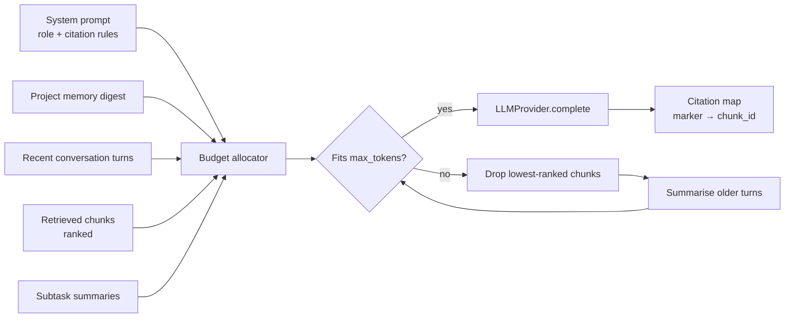

| Mechanism | Design |
|---|---|
| **Priority order** | System/citation rules > verified claims > top-ranked chunks > project memory digest > recent turns > lower-ranked chunks. Eviction happens from the bottom up. |
| **Chunk sizing** | ~500–800 tokens with overlap — large enough to be self-contained for citation, small enough to pack several into a window. |
| **Per-node budgets** | Each agent node declares its own `max_tokens`. The Summarizer works on one subtask's material, not the whole corpus; only Synthesis sees the assembled verified set. |
| **Progressive summarisation** | Long conversations and large retrieval sets are condensed by the `fast` tier before reaching a `strong`-tier call — cheap tokens compress so expensive tokens are spent on judgement. |
| **Citation map** | Context assembly builds an explicit marker → `chunk_id`/source mapping handed to the generator. Post-generation validation resolves every emitted marker against this map. |
| **Deduplication** | Near-duplicate chunks (common when a document repeats a definition) are collapsed before assembly to avoid wasting budget on redundancy. |
| **Overflow is a design event, not an exception** | If content cannot be reduced to fit, the run splits the work into more subtasks rather than truncating silently. |

---

## 5. Frontend Design

### 5.1 Application Layout

Three top-level layout regions, established in Phase 2 and never reshuffled afterwards:

| Region | Used by | Composition |
|---|---|---|
| **Marketing shell** | `/`, and any public page | Simple header, hero, feature explanation, footer. Explains what Aegis Research OS does. |
| **Auth shell** | `/login`, `/register` | Centred single-column card, minimal chrome, no navigation to protected areas. |
| **Workspace shell** | `/dashboard`, `/projects/[id]/*` | Persistent left navigation + top bar + main content area. This is where the product lives. |

The workspace shell is a **persistent layout**: navigating between Chat, Documents, Reports, and Settings swaps only the main content region. Navigation state, theme, and scroll position survive tab changes.

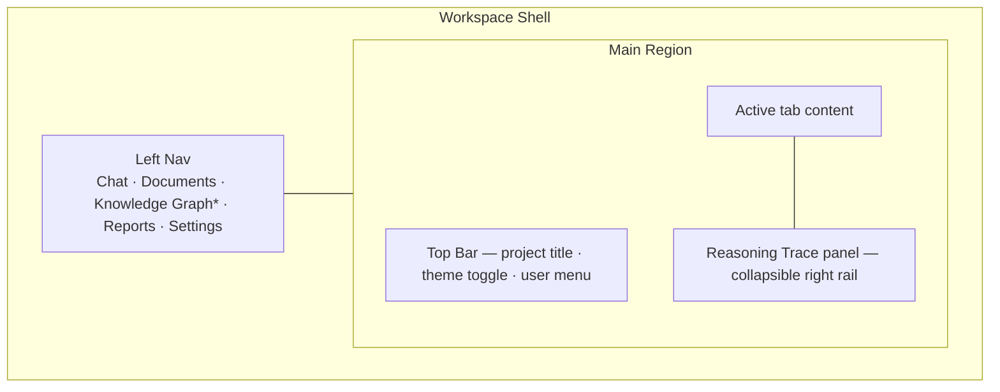

`*` Knowledge Graph appears in navigation from Phase 2 but is labelled "coming soon" until Phase 7 ships. Placeholder honesty is a requirement: unbuilt features show a labelled empty state, never fabricated data.

### 5.2 Navigation

| Level | Elements |
|---|---|
| **Global** | Logo → dashboard, theme toggle, user menu (profile, log out) |
| **Workspace left nav** | Chat, Documents, Knowledge Graph (stretch), Reports, Settings — icon + label, active state clearly indicated |
| **Contextual** | Breadcrumb `Dashboard / {Project title} / {Tab}`; in-tab controls such as the Generate panel's artifact-type selector |
| **Mobile** | Left nav collapses into a hamburger-triggered drawer; the trace panel becomes a bottom sheet |

**Route map**

| Route | Purpose | Auth |
|---|---|---|
| `/` | Landing page | Public |
| `/login`, `/register` | Authentication | Public (redirect to dashboard if already signed in) |
| `/dashboard` | Project list, create-project modal | Protected |
| `/projects/[id]` | Workspace — defaults to Chat | Protected |
| `/projects/[id]/documents` | Upload and manage documents | Protected |
| `/projects/[id]/reports` | Generated artifacts and exports | Protected |
| `/projects/[id]/graph` | Knowledge graph (stretch) | Protected |
| `/projects/[id]/settings` | Project settings; members in Phase 10 | Protected |

Protected routes redirect unauthenticated users to `/login` with a return path.

### 5.3 Dashboard

The dashboard answers one question: *which piece of research am I picking up?*

- **Project cards** — title, description, document count, last activity, and an overflow menu (open, delete).
- **Create project** — primary action rendered as both a header button and a card-shaped affordance in the grid; opens a modal with title + description.
- **Empty state** — when the user has no projects, an illustration, a one-line explanation of what a project is, and a single prominent create action. No fake sample cards.
- **Loading state** — skeleton cards matching the real card geometry, so there is no layout shift when data arrives.

Inside a project, the **Chat tab** is the default landing surface because asking a question is the most common intent. The **Generate panel** (Phase 6) sits alongside chat: pick an artifact type (Literature Review / Gap Analysis / Comparison / Survey), watch progress in the trace panel, read the rendered Markdown with clickable citations.

### 5.4 Design System

| Layer | Choice | Why |
|---|---|---|
| Styling | Tailwind CSS | Utility-first keeps styling colocated with components; no separate stylesheet drift |
| Components | shadcn/ui | Accessible Radix primitives, owned in-repo so they can be themed rather than fought |
| Animation | Framer Motion | Declarative, interruptible transitions for panels, modals, and streaming content |
| Icons | One icon set throughout (lucide, shipped with shadcn/ui) | Visual consistency |
| Tokens | CSS custom properties for colour, spacing, radius, shadow | Single source for both themes |

**Spacing** follows a 4 px base scale (4/8/12/16/24/32/48/64). **Radius** is defined once per element class (inputs and buttons share one radius, cards and panels another). **Elevation** uses three levels only: flat, raised (cards), and overlay (modals, popovers).

### 5.5 Typography

| Role | Family | Usage |
|---|---|---|
| UI / headings | A single geometric or neutral sans (e.g. Inter) | All interface chrome and headings |
| Long-form reading | The same sans at a reading-optimised size and line height | Generated artifacts, where the user reads paragraphs, not labels |
| Code / identifiers | Monospace | Citation identifiers, trace payloads, IDs |

| Token | Size / line-height | Applied to |
|---|---|---|
| `display` | 36–48 / 1.1 | Landing hero |
| `h1` | 30 / 1.2 | Page titles |
| `h2` | 24 / 1.3 | Artifact section headings |
| `h3` | 20 / 1.4 | Subsections |
| `body` | 16 / 1.6 | Default text and generated prose |
| `body-sm` | 14 / 1.5 | Secondary text, metadata |
| `caption` | 12 / 1.4 | Timestamps, trace metrics |
| `mono` | 13 / 1.5 | Code, IDs |

Generated artifact content uses a constrained measure (roughly 70–80 characters) because these documents are meant to be *read*, not skimmed. Markdown rendering maps heading levels to the same type scale so an exported PDF and the on-screen artifact feel like the same document.

### 5.6 Colour Palette

Semantic tokens, defined once per theme. Components reference tokens, never raw hex values.

| Token | Role |
|---|---|
| `background` / `foreground` | Page canvas and default text |
| `card` / `card-foreground` | Raised surfaces |
| `popover` / `popover-foreground` | Overlays |
| `primary` / `primary-foreground` | Primary actions, active nav state |
| `secondary` / `secondary-foreground` | Secondary actions, subtle fills |
| `muted` / `muted-foreground` | Disabled states, metadata text |
| `accent` / `accent-foreground` | Hover fills, highlights |
| `destructive` / `destructive-foreground` | Delete actions, hard errors |
| `success`, `warning`, `info` | Status: `ready`, OCR-quality flags and unverified claims, neutral notices |
| `border`, `input`, `ring` | Boundaries and focus rings |

**Domain-specific colour meanings**, kept consistent everywhere they appear:

| Meaning | Token | Appears in |
|---|---|---|
| Document `ready` | `success` | Document list, upload progress |
| Document `processing` / `pending` | `info` | Document list |
| Document `failed` | `destructive` | Document list, error toasts |
| Low OCR confidence | `warning` | Document detail flag |
| Verified claim | `success` | Fact-checker output, artifact annotations |
| Unsupported claim flagged by Critic | `warning` | Artifact review notice, trace panel |
| Citation reference | `primary` | Inline citation chips in answers and artifacts |
| Agent step succeeded / failed | `success` / `destructive` | Reasoning Trace panel |

### 5.7 Component Hierarchy

```
app/
├── (marketing)/page.tsx            Landing
├── (auth)/login, register          Auth shell
└── (workspace)/
    ├── layout.tsx                  WorkspaceShell
    ├── dashboard/page.tsx
    └── projects/[id]/
        ├── layout.tsx              ProjectShell (nav + top bar + trace rail)
        ├── page.tsx                Chat
        ├── documents/page.tsx
        ├── reports/page.tsx
        ├── graph/page.tsx          stretch
        └── settings/page.tsx

components/
├── ui/                             shadcn/ui primitives (button, dialog, toast, skeleton, …)
├── layout/                         AppShell · SideNav · TopBar · MobileDrawer · ThemeToggle
├── auth/                           LoginForm · RegisterForm · AuthGuard
├── projects/                       ProjectCard · ProjectGrid · CreateProjectModal · ProjectEmptyState
├── documents/                      DocumentDropzone · DocumentList · DocumentRow(status badge)
│                                   · DocumentMetadataPanel · DeleteDocumentDialog
├── chat/                           ChatPanel · MessageList · MessageBubble · StreamingMessage
│                                   · CitationChip · CitationPopover · ChatInput
├── trace/                          TracePanel · TraceStep · TraceMetrics · TraceEmptyState
├── generate/                       GeneratePanel · ArtifactTypeSelector · GenerationProgress
├── reports/                        ReportList · ReportViewer(Markdown) · ExportMenu
├── graph/                          GraphCanvas · NodeInspector · GraphFilters      (stretch)
└── feedback/                       EmptyState · LoadingSkeleton · ErrorState · Toaster
```

Composition rules: `ui/` primitives are presentational and stateless; feature folders own data fetching and feature state; `layout/` never imports from a feature folder (dependencies point inward, toward primitives).

### 5.8 Responsive Behaviour

| Breakpoint | Layout |
|---|---|
| `< 640px` (mobile) | Single column. Left nav → hamburger drawer. Trace panel → bottom sheet. Dashboard cards stack. Document list becomes stacked rows, not a horizontally scrolling table. |
| `640–1024px` (tablet) | Two-column dashboard grid. Left nav collapses to icon rail. Trace panel opens as an overlay. |
| `1024–1440px` (laptop) | Full left nav with labels. Three-column dashboard. Trace panel docks as a right rail, collapsed by default. |
| `> 1440px` (desktop) | Content max-width caps so generated artifacts keep a readable measure; extra space goes to the trace rail. |

Requirements that apply at every width: no horizontal scrolling of primary content, touch targets at least 44 px on touch devices, and no layout shift between empty, loading, and populated states.

### 5.9 Accessibility Standards

Target: **WCAG 2.1 AA**.

| Area | Commitment |
|---|---|
| Semantics | Landmark elements (`nav`, `main`, `aside`), correct heading order, lists as lists |
| Keyboard | Every interactive element reachable and operable by keyboard; logical tab order; no keyboard traps in modals or the trace panel |
| Focus | Visible focus ring on all focusable elements using the `ring` token; focus moves into a dialog on open and returns to the trigger on close |
| Contrast | 4.5:1 for body text, 3:1 for large text and UI boundaries — verified in **both** themes |
| Forms | Programmatic label association, inline error text tied via `aria-describedby`, errors announced not just coloured |
| Live regions | Streaming answers and trace updates announced politely via `aria-live="polite"`; toasts announced without stealing focus |
| Status not by colour alone | Document status, verification state, and trace outcomes carry an icon and text label alongside colour |
| Motion | Animations respect `prefers-reduced-motion` |
| Images | Meaningful alt text; decorative illustrations marked `aria-hidden` |

Honest limitation, stated for the report: automated checks and manual keyboard testing are in scope. Full AA validation additionally requires testing with real assistive technologies and expert accessibility review, which this project does not claim to have completed.

### 5.10 Dark / Light Themes

Both themes are designed, not derived. The dark theme is not an inversion of the light theme — it uses its own surface ramp and desaturated accents so that long reading sessions on generated artifacts stay comfortable.

| Concern | Design |
|---|---|
| Mechanism | `class`-based theme on `<html>`, driving CSS custom-property sets |
| Persistence | Preference stored client-side and applied before first paint to avoid a flash of the wrong theme |
| Default | Follow the OS `prefers-color-scheme`, overridable by the toggle |
| Dark surfaces | Layered near-neutral dark surfaces (page → card → overlay), avoiding pure black to reduce halation |
| Dark accents | Reduced saturation, raised luminance so primary and status colours stay legible without glowing |
| Verification | Contrast ratios checked independently per theme; screenshots of both captured for the report |

### 5.11 State Management

Deliberately lightweight — no global state library where the platform already provides an answer.

| State kind | Mechanism | Examples |
|---|---|---|
| Server data | React Server Components + fetch on the server where possible; a typed API client for client-side reads | Project list, documents, reports, trace history |
| Auth session | Auth context over an httpOnly cookie or token store, with a refresh interceptor | Current user, access/refresh tokens, route protection |
| Streaming run state | Local component state fed by the streaming response and trace updates | In-flight answer tokens, live agent steps |
| Ephemeral UI | Local `useState` / URL search params | Modal open, trace panel collapsed, active filter, pagination |
| Cross-cutting preferences | Small context providers | Theme, toast queue |

Rules: the URL is the source of truth for anything shareable or refresh-surviving (active project, tab, filters). Server data is never duplicated into a client store as a second source of truth. Mutations invalidate and refetch rather than hand-patching caches, except for genuinely optimistic actions (project creation, document deletion) where the rollback path is trivial.

Long-running operations follow one pattern everywhere: **start → receive `run_id`/resource id → observe progress (poll or stream) → settle into a terminal state**. Document ingestion and agent runs use the same shape, so the UI code and the mental model are shared.

---

## 6. Backend Design

### 6.1 API Architecture

REST over JSON, with a **uniform response envelope** on every endpoint — success and failure alike. This means the frontend has exactly one response-handling path.

```json
{ "success": true, "data": { }, "error": null }
```

```json
{ "success": false, "data": null, "error": { "code": "VALIDATION_ERROR", "message": "..." } }
```

**Conventions**

| Convention | Rule |
|---|---|
| Pagination | `?page=&page_size=`, returning `data.items` + `data.total` |
| Auth | All authenticated endpoints require `Authorization: Bearer <token>` |
| Scoping | Project-owned resources are addressed under `/projects/{id}/…`; scope is authorised server-side on every request |
| Versioning | Routers mounted under a version prefix so a future breaking change does not require a flag day |
| Async | Long operations return an identifier immediately; progress is observed via a status resource or the trace endpoint |
| Errors | Machine-readable `error.code` plus a human-readable `error.message`; codes are a closed enum |

**Core endpoints (MVP)**

| Method | Path | Purpose |
|---|---|---|
| POST | `/auth/register` | Create account |
| POST | `/auth/login` | Get access/refresh tokens |
| POST | `/auth/refresh` | Refresh access token |
| GET | `/auth/me` | Current user info |
| GET / POST | `/projects` | List / create projects |
| GET / DELETE | `/projects/{id}` | Get / delete a project |
| POST | `/projects/{id}/documents` | Upload a document (multipart) |
| GET | `/projects/{id}/documents` | List documents + status |
| GET | `/documents/{id}` | Document detail + processing status |
| DELETE | `/documents/{id}` | Delete a document and its chunks |
| POST | `/projects/{id}/query` | Run hybrid RAG / agent query |
| GET | `/projects/{id}/traces/{run_id}` | Get agent reasoning trace |
| POST | `/projects/{id}/reports` | Generate a research artifact |
| GET | `/projects/{id}/reports` | List generated reports |
| GET | `/projects/{id}/reports/{id}/export?format=` | Export report (pdf \| docx \| latex) |

**Stretch endpoints** follow the same conventions: graph retrieval (`/projects/{id}/graph`), dataset upload and analysis (`/projects/{id}/datasets`), membership management (`/projects/{id}/members`), activity log (`/projects/{id}/activity`), and usage stats (`/projects/{id}/usage`).

### 6.2 Authentication

JWT-based, with bcrypt password hashing. `fastapi-users` or a hand-rolled implementation are both acceptable; the contract matters more than the library.

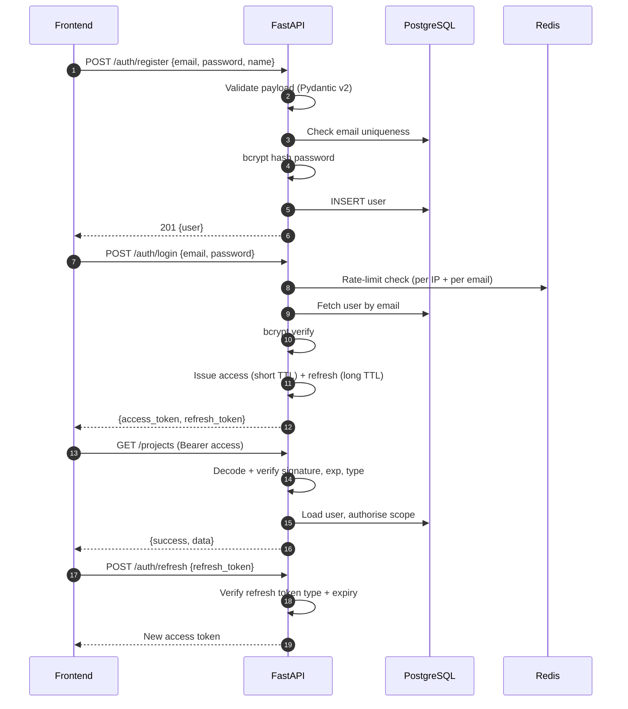

| Element | Design |
|---|---|
| Access token | Short-lived, carries subject (user id) and token type; sent on every request |
| Refresh token | Longer-lived, exchanged only at `/auth/refresh`; typed so an access token cannot be used as a refresh token, or vice versa |
| Hashing | bcrypt with a per-password salt; plaintext never stored, never logged |
| Current user | A single FastAPI dependency (`get_current_user`) resolves and caches the user per request; every protected route depends on it |
| Failure mode | Missing/invalid/expired token → 401 with `error.code = "UNAUTHENTICATED"` |

### 6.3 Authorization

Two layers, both server-side.

**Layer 1 — resource scope (MVP).** Every project-scoped resource resolves through a dependency that confirms the caller may access the project. Access to a project the caller does not own returns **404, not 403** — the API does not confirm the existence of resources the caller cannot see. Chunks, messages, traces, and reports are always reached via their project, so there is no path that returns another tenant's data.

**Layer 2 — role-based access control (Phase 10 stretch).** Project membership adds owner/editor/viewer. The permission matrix in [§2.2](#22-user-roles) is enforced by a `require_role(...)` dependency on each mutating route. The acceptance criterion is behavioural: an invited viewer attempting an upload or delete is rejected by the API, regardless of what the UI shows.

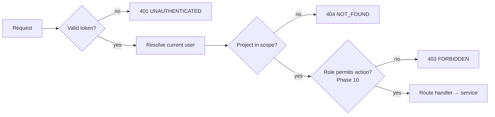

### 6.4 Services

Services hold all business logic. They accept and return Pydantic models, never `Request` or ORM sessions created ad hoc, which keeps them unit-testable without HTTP.

| Service | Responsibility | Key collaborators |
|---|---|---|
| `AuthService` | Registration, credential verification, token issuance/refresh, user lookup | `security`, `UserRepository` |
| `ProjectService` | Project CRUD, cascade deletion, scope checks | `ProjectRepository` |
| `IngestionService` | Validate → extract (PDF/DOCX/OCR) → metadata → chunk → embed → persist; own the status lifecycle | `EmbeddingService`, `DocumentRepository` |
| `EmbeddingService` | Load the sentence-transformers model once, batch-encode chunks and queries | model runtime |
| `RetrievalService` | Vector search, FTS, RRF fusion, optional cross-encoder re-rank, metadata filters, context assembly + citation map | `ChunkRepository`, `EmbeddingService` |
| `AgentService` | Start/observe agent runs, own the LangGraph compiled graph, emit traces | `app/agents`, `LLMProvider`, `RetrievalService`, `ExternalSourceService` |
| `ExternalSourceService` | arXiv, Semantic Scholar, CORE, CrossRef, web search connectors; normalisation, caching, fail-soft | `CacheService` |
| `MemoryService` | Read/write project-level memory; distil durable facts with citations | `LLMProvider`, repositories |
| `ReportService` | Artifact persistence, citation-integrity validation, executive summary | `AgentService` |
| `ExportService` | Markdown → PDF / DOCX / LaTeX rendering | rendering toolchain |
| `CacheService` | Typed Redis helpers: LLM cache, external-source cache, rate-limit counters, run status | Redis |
| `GraphService` *(stretch)* | Entity/relationship extraction and graph queries | `LLMProvider`, repositories |
| `AnalyticsService` *(stretch)* | CSV profiling, sandboxed code execution, chart generation | pandas, sandbox runtime |

Dependency direction is strict: `api → services → repositories/core`. A service may call another service; a repository never calls a service; nothing below the API layer imports FastAPI request objects.

### 6.5 Controllers (Routers)

FastAPI routers are the controllers, and they stay thin — validate, authorise, delegate, envelope.

| Router | Prefix | Notes |
|---|---|---|
| `auth` | `/auth` | Register, login, refresh, me. Rate-limited. |
| `projects` | `/projects` | CRUD, scope dependency applied at router level |
| `documents` | `/projects/{id}/documents`, `/documents/{id}` | Upload validation, background dispatch, status |
| `query` | `/projects/{id}/query` | Runs RAG (Phase 4) or the agent graph (Phase 5+); streams the response |
| `traces` | `/projects/{id}/traces` | Ordered trace for a run |
| `reports` | `/projects/{id}/reports` | Generate, list, export |
| `health` | `/health` | Liveness/readiness, no auth |

A router must not contain retrieval logic, prompt text, SQL, or provider calls. If a handler exceeds a screen, the logic belongs in a service.

### 6.6 Database Layer

| Element | Design |
|---|---|
| ORM | SQLAlchemy 2.0, async engine and session, typed declarative models |
| Migrations | Alembic exclusively. No `create_all` in application code. The initial migration enables the `pgvector` extension. |
| Sessions | One session per request via dependency injection; commit at the end of a successful unit of work, rollback on exception |
| Repositories | Thin query objects per aggregate (`UserRepository`, `ProjectRepository`, `DocumentRepository`, `ChunkRepository`, `ConversationRepository`, `TraceRepository`, `ReportRepository`). Raw SQL is permitted inside repositories for vector and FTS queries, never outside them. |
| Vectors | pgvector column on `document_chunks`; similarity expressed through SQLAlchemy with the pgvector dialect helpers |
| Cascades | Project deletion cascades to documents → chunks, conversations → messages → traces, and reports, at the database level |
| IDs | UUID primary keys throughout, generated application-side so an object can be referenced before flush |
| Timestamps | `created_at` (and `updated_at` where mutation occurs) on every table, timezone-aware UTC |
| JSONB | Used for genuinely open-ended structures — `documents.metadata`, `document_chunks.source_ref`, `messages.citations` — never as a substitute for modelling a known relation |

### 6.7 Background Workers

The MVP uses **FastAPI `BackgroundTasks`**. `arq` (or Celery) is introduced only if a stretch phase requires durable queues — this is a stated infrastructure-simplification decision, not an oversight.

| Job | Trigger | Observability | Failure handling |
|---|---|---|---|
| Document ingestion | `POST /projects/{id}/documents` | `documents.status`: `pending` → `processing` → `ready` \| `failed` | Per-document isolation; a failure records a human-readable reason and never blocks other documents |
| Agent run | `POST /projects/{id}/query`, `POST /projects/{id}/reports` | `run_id` + incremental `agent_traces` rows; run status in Redis | Node-level failure recorded in the trace; partial results returned where useful |
| Export rendering | `GET …/export?format=` | Synchronous for small artifacts; backgrounded with a status for large ones | Format-specific error surfaced to the user, other formats unaffected |

Design constraints for all background work: **idempotent** (safe to re-run after a crash), **progress-observable from the database** (not only from process memory, so a restart does not orphan a job invisibly), and **cancellable** for agent runs.

### 6.8 Caching

Redis, with a clear key taxonomy so cache behaviour is auditable — and measurable, since caching impact is a reportable metric.

| Cache | Key | TTL | Purpose |
|---|---|---|---|
| LLM responses | `llm:{sha256(prompt + model_tier + sorted(doc_ids))}` | Medium | Avoid recomputing identical completions; the single largest cost saving |
| External sources | `ext:{provider}:{sha256(normalised_query)}` | Medium–long | Repeated academic/web lookups across agents and runs |
| Embeddings (queries) | `emb:{sha256(text + model_id)}` | Short | Repeated identical queries within a session |
| Rate limits | `rl:{scope}:{identifier}` | Window-length | Auth and query throttling |
| Run status | `run:{run_id}` | Short | Fast status/progress reads for the trace panel |

Rules: **cache keys include every input that changes the output** (notably `model_tier` and the relevant document IDs); a cache hit is recorded in the trace as a zero-cost step so hit rate is derivable from `agent_traces`; a Redis outage degrades performance and cost but never correctness — every read path works with an empty cache.

### 6.9 Logging

Structured JSON logs, one event per line, correlated end to end.

| Field | Purpose |
|---|---|
| `timestamp`, `level`, `logger` | Standard |
| `request_id` | Generated per HTTP request, returned in a response header |
| `run_id` | Present on every agent-run log line |
| `user_id`, `project_id` | Scope, for filtering |
| `event` | Stable machine-readable name (`document.ingest.completed`, `agent.node.finished`, `llm.cache.hit`) |
| `duration_ms`, `tokens_in`, `tokens_out`, `estimated_cost_usd` | Performance and cost, where applicable |

Two distinct channels, and the distinction matters:

- **Operational logs** — stdout, for debugging and ops. Ephemeral.
- **Agent traces** — the `agent_traces` table, for the product feature, the demo, and the report's cost analysis. Durable and user-visible.

**Never logged:** passwords, tokens, API keys, or full document text. Log identifiers and summaries. `agent_traces` stores *input/output summaries*, not full payloads, for exactly this reason.

### 6.10 Error Handling

A single exception hierarchy maps to HTTP status codes and envelope codes in one place — a global exception handler. Handlers do not build error responses by hand.

| Exception | Status | `error.code` |
|---|---|---|
| `ValidationError` (Pydantic or domain) | 422 | `VALIDATION_ERROR` |
| `AuthenticationError` | 401 | `UNAUTHENTICATED` |
| `PermissionError` | 403 | `FORBIDDEN` |
| `NotFoundError` | 404 | `NOT_FOUND` |
| `ConflictError` (duplicate email) | 409 | `CONFLICT` |
| `RateLimitError` | 429 | `RATE_LIMITED` |
| `UnsupportedFileTypeError`, `FileTooLargeError` | 400 | `UNSUPPORTED_FILE_TYPE`, `FILE_TOO_LARGE` |
| `ExtractionError` | recorded, not raised to the user | document `status = failed` + reason |
| `LLMProviderError` | 502 | `LLM_PROVIDER_ERROR` |
| `ExternalSourceError` | non-fatal | warning in trace, run continues |
| `ExportError` | 500 | `EXPORT_FAILED` |
| Unhandled | 500 | `INTERNAL_ERROR` (generic message; details logged, never returned) |

**Principles**

1. **Fail loudly at boundaries, softly inside the pipeline.** A malformed request is rejected outright; a single dead external API degrades the run rather than killing it.
2. **Never surface internals.** Stack traces and provider error bodies go to logs, correlated by `request_id`; the client receives a stable code and a safe message.
3. **Partial success is a first-class outcome.** An agent run that completes with a failed node returns what it has, clearly marked, with the failure visible in the trace.
4. **Errors are actionable.** "OCR confidence was low for this scanned PDF; extracted text may be unreliable" beats "processing failed".

---

## 7. Database Design

### 7.1 ER Diagram

```mermaid
erDiagram
    USERS ||--o{ PROJECTS : owns
    PROJECTS ||--o{ DOCUMENTS : contains
    DOCUMENTS ||--o{ DOCUMENT_CHUNKS : split_into
    PROJECTS ||--o{ CONVERSATIONS : has
    CONVERSATIONS ||--o{ MESSAGES : contains
    MESSAGES ||--o{ AGENT_TRACES : produced_by
    PROJECTS ||--o{ REPORTS : generates

    USERS {
        uuid id PK
        string email
        string hashed_password
        string name
        timestamp created_at
    }
    PROJECTS {
        uuid id PK
        uuid owner_id FK
        string title
        string description
        timestamp created_at
    }
    DOCUMENTS {
        uuid id PK
        uuid project_id FK
        string filename
        string status
        jsonb metadata
        timestamp uploaded_at
    }
    DOCUMENT_CHUNKS {
        uuid id PK
        uuid document_id FK
        uuid project_id FK  # Denormalized for efficient project-scoped retrieval
        int chunk_index
        text content
        vector embedding
        jsonb source_ref
    }
    CONVERSATIONS {
        uuid id PK
        uuid project_id FK
        string title
        timestamp created_at
    }
    MESSAGES {
        uuid id PK
        uuid conversation_id FK
        string role
        text content
        jsonb citations
        timestamp created_at
    }
    AGENT_TRACES {
        uuid id PK
        uuid message_id FK
        uuid run_id FK  # Links traces belonging to the same run, even before message is persisted
        string agent_name
        text input_summary
        text output_summary
        int tokens_used
        float latency_ms
        float estimated_cost
        timestamp created_at
    }
    REPORTS {
        uuid id PK
        uuid project_id FK
        string type
        text content_markdown
        string status
        timestamp created_at
    }
```

**Stretch-phase extensions** (added only when the corresponding phase begins, each in its own migration):

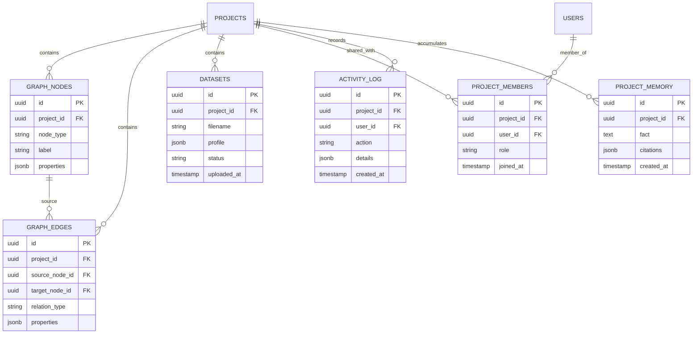

### 7.2 Tables

#### `users`
Identity and credentials.

| Column | Type | Notes |
|---|---|---|
| `id` | UUID PK | Application-generated |
| `email` | text, **unique, not null** | Login identifier; stored lower-cased |
| `hashed_password` | text, not null | bcrypt hash |
| `name` | text | Display name |
| `created_at` | timestamptz, not null | Default now |

#### `projects`
A research workspace. The tenancy boundary for all content.

| Column | Type | Notes |
|---|---|---|
| `id` | UUID PK | |
| `owner_id` | UUID FK → `users.id` | `ON DELETE CASCADE` |
| `title` | text, not null | |
| `description` | text | Nullable |
| `created_at` | timestamptz, not null | |

#### `documents`
One uploaded source file and its processing state.

| Column | Type | Notes |
|---|---|---|
| `id` | UUID PK | |
| `project_id` | UUID FK → `projects.id` | `ON DELETE CASCADE` |
| `filename` | text, not null | Original name, sanitised |
| `status` | text, not null | `pending` \| `processing` \| `ready` \| `failed` |
| `metadata` | JSONB | Title, authors (best-effort), page count, MIME type, size, OCR-used flag, OCR-confidence flag, failure reason |
| `uploaded_at` | timestamptz, not null | |

#### `document_chunks`
The retrieval unit. Carries both the embedding and the provenance needed for citation.

| Column | Type | Notes |
|---|---|---|
| `id` | UUID PK | |
| `document_id` | UUID FK → `documents.id` | `ON DELETE CASCADE` |
| `chunk_index` | int, not null | Order within the document |
| `content` | text, not null | ~500–800 tokens with overlap |
| `embedding` | `vector(d)` | `d` fixed by the embedding model |
| `source_ref` | JSONB | Page number, section heading, char offsets — the basis of `[Doc 2, p.4]` |

A generated `tsvector` column (or an expression index) over `content` provides the keyword half of hybrid retrieval. `project_id` is denormalised onto this table so project-scoped vector search filters without a join — a deliberate read-optimisation for the hottest query in the system.

#### `conversations` / `messages`
Chat history, project-scoped, with citations preserved.

| `conversations` | Type | Notes |
|---|---|---|
| `id` | UUID PK | |
| `project_id` | UUID FK → `projects.id` | Cascade |
| `title` | text | Derived from the first message |
| `created_at` | timestamptz | |

| `messages` | Type | Notes |
|---|---|---|
| `id` | UUID PK | |
| `conversation_id` | UUID FK → `conversations.id` | Cascade |
| `role` | text, not null | `user` \| `assistant` |
| `content` | text, not null | Markdown for assistant messages |
| `citations` | JSONB | Ordered list of `{marker, chunk_id?, document_id?, external_source?, page}` — the record that makes citation validity auditable after the fact |
| `created_at` | timestamptz | |

#### `agent_traces`
The observability spine and a user-facing feature.

| Column | Type | Notes |
|---|---|---|
| `id` | UUID PK | |
| `message_id` | UUID FK → `messages.id` | Cascade; links a trace to the answer it produced |
| `agent_name` | text, not null | Supervisor, Retrieval, Summarizer, … |
| `input_summary` | text | Summary, never the full payload |
| `output_summary` | text | Summary |
| `tokens_used` | int | 0 on a cache hit |
| `latency_ms` | float | |
| `estimated_cost` | float | 0 on a cache hit |
| `created_at` | timestamptz | Also defines step ordering |

A `run_id` is carried on trace rows so `GET /projects/{id}/traces/{run_id}` can return an ordered run even before the assistant message is finalised.

#### `reports`
Generated artifacts. Markdown is the source of truth; exports are derived on demand.

| Column | Type | Notes |
|---|---|---|
| `id` | UUID PK | |
| `project_id` | UUID FK → `projects.id` | Cascade |
| `type` | text, not null | `literature_review` \| `gap_analysis` \| `comparison` \| `survey` \| `executive_summary` |
| `content_markdown` | text | The artifact |
| `status` | text, not null | `pending` \| `generating` \| `ready` \| `failed` |
| `created_at` | timestamptz | |

#### Stretch tables
`graph_nodes` / `graph_edges` (Phase 7 — relational graph modelling, deliberately avoiding Neo4j), `datasets` (Phase 8), `project_members` / `activity_log` (Phase 10), and `project_memory` (Phase 5, backing the Memory agent's durable facts with their citations).

### 7.3 Relationships

| Relationship | Cardinality | Delete behaviour |
|---|---|---|
| `users` → `projects` | 1 : N | Cascade |
| `projects` → `documents` | 1 : N | Cascade |
| `documents` → `document_chunks` | 1 : N | Cascade |
| `projects` → `conversations` | 1 : N | Cascade |
| `conversations` → `messages` | 1 : N | Cascade |
| `messages` → `agent_traces` | 1 : N | Cascade |
| `projects` → `reports` | 1 : N | Cascade |
| `projects` → `project_memory` | 1 : N | Cascade |
| `projects` → `graph_nodes` → `graph_edges` | 1 : N : N | Cascade |
| `projects` ↔ `users` via `project_members` | M : N | Cascade both sides |

Deleting a project therefore removes every trace of its content in one transaction — which is both the correct data-privacy behaviour for uploaded documents and the simplest possible cleanup story.

### 7.4 Indexing Strategy

Indexes exist for identified query patterns, each justified.

| Table | Index | Serves |
|---|---|---|
| `users` | unique on `email` | Login lookup, uniqueness enforcement |
| `projects` | `(owner_id, created_at DESC)` | Dashboard listing |
| `documents` | `(project_id, uploaded_at DESC)` | Documents tab |
| `documents` | `(project_id, status)` partial on non-`ready` | Polling in-flight ingestion |
| `document_chunks` | **Composite ANN index `(project_id, embedding)`** (HNSW with project_id prefix) with cosine ops | Efficient project-scoped semantic search |
| `document_chunks` | **ANN index on `embedding`** (HNSW preferred; IVFFlat acceptable) with cosine ops | Global semantic search (secondary, less efficient) |
| `document_chunks` | **GIN on the `tsvector` of `content`** | Keyword/FTS search |
| `document_chunks` | `(document_id, chunk_index)` | Ordered reconstruction, citation resolution |
| `document_chunks` | `(project_id)` | Scope filter on the hot retrieval path (supports composite index) |
| `messages` | `(conversation_id, created_at)` | Chat history pagination |
| `agent_traces` | `(run_id, created_at)` | Trace panel, in order |
| `agent_traces` | `(message_id)` | Trace for a completed answer |
| `reports` | `(project_id, created_at DESC)` | Reports tab |
| `graph_edges` | `(project_id, source_node_id)`, `(project_id, target_node_id)` | Graph traversal (stretch) |
| `project_members` | unique `(project_id, user_id)` | Membership lookup, no duplicates (stretch) |

**Notes on the vector index.** ANN indexes are approximate: recall depends on build parameters and search-time effort. Two consequences are designed for. First, hybrid retrieval hedges — the keyword path catches exact-term matches that an approximate vector search may miss. Second, the ANN index is built **after** bulk ingestion where possible, since building on an empty or near-empty table gives poor structure. Index parameters are recorded in the migration so retrieval measurements in the report are reproducible.

**Notes on FTS.** Postgres full-text search provides the BM25-like keyword ranking half of hybrid retrieval. `ts_rank` supplies the ordering that feeds reciprocal rank fusion. Keeping both retrieval modes in one engine means a single `WHERE project_id = ...` predicate scopes both — no cross-system consistency problem.

### 7.5 Multi-Tenancy

**Model: shared schema, row-level scoping, project as the tenancy boundary.**

| Layer | Mechanism |
|---|---|
| Data model | Every content table reaches `projects` by foreign key; `projects.owner_id` (MVP) or `project_members` (Phase 10) defines who may access it |
| Query layer | Repository methods that touch project content **require** a `project_id` argument. There is no repository method that returns chunks, messages, traces, or reports across projects. |
| API layer | Project-scope dependency authorises before any handler body executes; unauthorised access returns 404 |
| Retrieval layer | `project_id` is denormalised onto `document_chunks` so the scope predicate is applied inside the vector and FTS queries themselves, not filtered after the fact |
| Agent layer | `AgentRunState` carries `project_id`; every tool call inherits it. An agent cannot construct a cross-project search. |
| Cache layer | Project-scoped cache keys include `project_id`; LLM cache keys include the relevant document IDs, which are themselves project-scoped |

Postgres row-level security is intentionally not used: with a single application service that always scopes at the repository boundary, RLS would add operational complexity without closing a real gap. Scoping is instead enforced by making the unsafe query *unwritable* through the repository API — and covered by tests that assert cross-tenant access returns 404.

---

## 8. Search & Knowledge Architecture

This section describes the full path from an uploaded file to a citation in an exported report. It is the technical heart of the product.

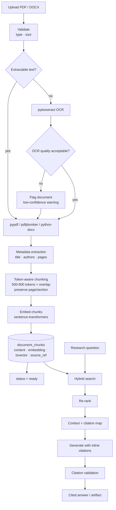

### 8.1 Document Ingestion

Ingestion is asynchronous, per-document isolated, and idempotent. Large documents (> 50 MB or > 100 pages) are processed in streaming chunks to avoid memory exhaustion. Document size and page limits are configurable with clear error messages when exceeded.

| Stage | Behaviour |
|---|---|
| Accept | `POST /projects/{id}/documents` (multipart). Validate extension and MIME against an allow-list (PDF, DOCX) and enforce configurable maximum size (default: 100 MB). Reject anything else with a clear error before any bytes are processed. |
| Record | Insert a `documents` row with `status = pending` and return immediately — the upload response must not wait on processing. |
| Dispatch | Hand the document id to a background task. |
| Process | Transition to `processing`, run the pipeline, then to `ready` or `failed`. |
| Observe | `GET /documents/{id}` returns the current status; the frontend polls until terminal. |
| Isolate | A failure affects exactly one document. Its `metadata` records a human-readable reason. |

Re-running ingestion for a document deletes and rebuilds its chunks rather than appending, so a retry after a crash cannot produce duplicates.

### 8.2 Parsing

| Input | Primary path | Fallback |
|---|---|---|
| Digital PDF | `pypdf` / `pdfplumber` — text with page boundaries retained | — |
| Scanned PDF | Detected by negligible extractable text | `pytesseract` OCR, page by page |
| DOCX | `python-docx` — paragraphs, headings, tables, with heading structure retained | — |

**The OCR honesty rule.** If OCR quality is poor, the document is **flagged** rather than silently ingested. A low-confidence flag is stored in `documents.metadata`, surfaced as a `warning`-toned badge in the UI, and carried into any citation drawn from that document. The alternative — quietly embedding garbage text — produces confidently wrong answers, which is the single worst failure mode for a research tool.

Parsing preserves structure that citation depends on: page numbers for PDFs, heading hierarchy for DOCX. Structure discarded at parse time cannot be recovered later.

### 8.3 Chunking

| Parameter | Decision | Rationale |
|---|---|---|
| Size | ~500–800 tokens | Large enough that a chunk stands alone as evidence a reader can verify; small enough that several fit in a context window alongside memory and instructions |
| Boundary | Token-aware, respecting paragraph and section boundaries where possible | Avoids severing a claim from its qualifier |
| Overlap | Modest overlap between adjacent chunks | Prevents a claim spanning a boundary from being lost by both chunks |
| Counting | Tokens, not characters | Character-based sizing produces wildly variable token counts and breaks budget arithmetic |
| Provenance | Every chunk stores page/section reference in `source_ref` | This is what makes `[Doc 2, p.4]` verifiable rather than decorative |
| Ordering | `chunk_index` preserved | Allows neighbour expansion and ordered reconstruction |

Chunking is where citation quality is actually determined. A chunk that cannot be pointed at precisely cannot be cited honestly, so provenance is captured at creation time, never inferred afterwards.

### 8.4 Metadata Extraction

Best-effort, explicitly labelled as such. Stored in `documents.metadata` (JSONB) because the available fields vary by source.

| Field | Source | Use |
|---|---|---|
| `title` | PDF metadata, first-page heuristics, or DOCX heading | Display; citation label |
| `authors` | PDF metadata or first-page heuristics | Citation; graph entity extraction (stretch) |
| `page_count` | Parser | Display; citation bounds |
| `mime_type`, `size_bytes` | Upload | Validation record |
| `uploaded_at` | System | Date-range filtering |
| `ocr_used`, `ocr_low_confidence` | Pipeline | Reliability warning |
| `failure_reason` | Pipeline | Error state explanation |

Extraction is heuristic and may be wrong; the UI presents metadata as editable/inspectable rather than authoritative, and `crossref_lookup` can canonicalise a citation when a DOI or exact title is available.

### 8.5 Embeddings

Covered in [§4.3](#43-embedding-system). The points that matter for search correctness:

- The **same model** embeds chunks at ingestion and queries at retrieval. A mismatch silently destroys relevance.
- The model identifier is stored so a mismatch is **detectable**, and a re-embed script exists for deliberate model changes.
- Embedding runs in-process, so ingestion throughput is bounded by CPU rather than by an external rate limit.

### 8.6 Hybrid Search

Neither retrieval mode is sufficient alone. Semantic search finds paraphrase and conceptual matches but misses exact identifiers, rare terms, and specific numbers. Keyword search nails those and misses everything phrased differently. Hybrid search takes both and fuses them.

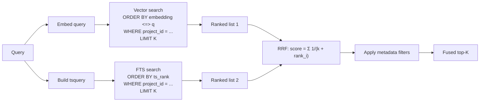

**Reciprocal Rank Fusion** is chosen deliberately over score normalisation. Cosine similarity and `ts_rank` are not on a comparable scale, and any attempt to normalise them requires corpus-dependent tuning that will not hold across projects. RRF uses only *rank position*, so it is scale-free and needs no per-corpus calibration — the right trade for a system whose corpora are entirely user-supplied and unpredictable.

**Metadata filtering** (specific documents, date range, section) applies as SQL predicates inside both retrieval queries, so filters shrink the candidate set rather than discarding results after ranking.

**External sources.** When a request needs material beyond the uploaded corpus, the Retrieval agent additionally queries arXiv, Semantic Scholar, CORE, and CrossRef, plus a web search provider (Tavily or SerpAPI). Results are normalised to a common `ExternalSource` shape, cached in Redis by normalised query, and merged into the evidence set as separately-labelled sources — an external source is never presented as if it came from the user's corpus.

### 8.7 Re-ranking

An optional refinement step over the fused top-K before context assembly.

| Aspect | Design |
|---|---|
| Model | Cross-encoder from `sentence-transformers` |
| Why it helps | A bi-encoder embeds query and chunk independently; a cross-encoder scores the pair jointly and is substantially better at judging genuine relevance |
| Why it is optional | It is the most expensive step in retrieval latency terms. Toggleable by configuration so its precision/latency trade-off can be **measured** against the gold set and reported |
| Where it sits | After RRF, over a bounded candidate set (tens of chunks), never over the whole corpus |
| Output | Reordered candidates; top-N passed forward |

This ordering — cheap recall first, expensive precision second — is the standard retrieve-then-rerank pattern, and it keeps the expensive model's workload independent of corpus size.

### 8.8 Citation Generation

Citations are treated as a data-integrity problem, not a formatting problem.

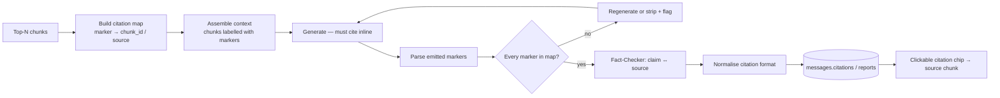

| Step | Detail |
|---|---|
| 1. Map | Context assembly assigns a stable marker to each supplied chunk or external source and records marker → identifier. |
| 2. Instruct | The system prompt requires inline citation using those markers and forbids citing anything not supplied. |
| 3. Parse | Emitted markers are extracted from the generated text. |
| 4. **Validate** | Every marker must resolve within the map. Unresolvable markers mean regeneration, or removal of the claim with an explicit flag. This is the enforcement point for the 100%-citation-validity metric. |
| 5. Verify | The Fact-Checker agent checks that each cited claim is actually supported by the cited source, not merely adjacent to it. Unsupported claims are flagged for the Critic. |
| 6. Normalise | Citations are normalised to a consistent form and enriched via `crossref_lookup` where a DOI or exact title is available. |
| 7. Persist | Stored in `messages.citations` / within the report Markdown, so validity remains auditable after the fact. |
| 8. Render | The UI renders each citation as a clickable chip that opens the source chunk with its page/section reference — the user can always check the system's work. |

Export preserves citations across all three formats. This is an explicit Phase 9 acceptance criterion: headings, citations, and tables must survive into PDF, DOCX, and LaTeX.

---

## 9. Security Design

Security is scoped proportionally: this is a single-tenant-per-user research tool handling user-uploaded documents and third-party API keys. The threat model that matters is credential compromise, cross-tenant data leakage, malicious uploads, cost-exhaustion abuse, and — if Phase 8 is built — arbitrary code execution.

### 9.1 Authentication Flow

See [§6.2](#62-authentication) for the sequence. Security-relevant properties:

| Property | Design |
|---|---|
| Password storage | bcrypt with per-password salt. Cost factor configurable. Plaintext never stored, logged, or echoed. |
| Password policy | Minimum length enforced at the Pydantic schema boundary. |
| Login response uniformity | Wrong email and wrong password return the same error, so login is not a user-enumeration oracle. |
| Registration | Duplicate email returns a conflict; this is an accepted enumeration trade-off for usability at this scale, and is noted rather than hidden. |
| Token issuance | Access + refresh issued on successful login only. |
| Throttling | Redis-backed rate limiting on all auth endpoints, keyed by IP and by account. |

### 9.2 JWT / Session Strategy

| Element | Decision | Reason |
|---|---|---|
| Access token | Short TTL, signed, carries `sub` (user id), `exp`, and a `type` claim | Limits the window of a leaked token |
| Refresh token | Longer TTL, `type: refresh`, accepted only at `/auth/refresh` | A stolen access token cannot be used to mint new tokens |
| Typed tokens | `type` claim checked on every use | Prevents refresh-for-access substitution |
| Algorithm & secret | Symmetric signing with a secret from the environment; algorithm pinned server-side | Prevents algorithm-confusion attacks |
| Storage | httpOnly cookie preferred; token storage acceptable as documented in Phase 1 | httpOnly removes the XSS token-theft path |
| Statelessness | No server session store in the MVP | Matches the "minimal infra" principle; the short access TTL bounds the cost of not having revocation |
| Token revocation | Redis blacklist for revoked tokens; on logout, tokens are added to denylist with TTL matching token expiry | Prevents use of stolen tokens after logout; essential for security |
| Documented limitation | Token blacklist requires Redis; Redis outage prevents new revocations (tokens remain valid until expiry) | |
| Logout | Client discards tokens; refresh is not reissued | Sufficient given short access TTLs |

### 9.3 RBAC

**MVP:** ownership-based access control. `projects.owner_id` is the only authority. Every project-scoped route resolves through a scope dependency; non-owners receive 404.

**Phase 10:** role-based access control via `project_members` with owner/editor/viewer, enforced by a `require_role` dependency. The full matrix is in [§2.2](#22-user-roles).

Enforcement rules that hold in both phases:

1. Authorisation is **server-side only**. UI hiding is convenience, never a control.
2. Authorisation happens **before** the handler body — as a dependency, so it cannot be forgotten in a code path.
3. Repository methods touching project content **require** `project_id`, making a cross-tenant query unwritable through the sanctioned API.
4. Non-existent and unauthorised resources are **indistinguishable** (both 404).
5. Cross-tenant access attempts are covered by tests, not just by review.

### 9.4 API Security

| Control | Design |
|---|---|
| Transport | HTTPS in staging/production; TLS terminated at the reverse proxy |
| CORS | Explicit allow-list of frontend origins; no wildcard with credentials |
| Security headers | HSTS, `X-Content-Type-Options`, `X-Frame-Options`/frame-ancestors, and a Content-Security-Policy served by the frontend/proxy |
| Request size limits | Global body-size cap plus a stricter per-upload cap |
| Method/route surface | Only declared routes exist; interactive API docs disabled or protected in production |
| Error opacity | Stable error codes and safe messages; stack traces and provider errors only in logs |
| Header hygiene | Server/framework version headers suppressed |
| Injection | No string-built SQL outside repositories; all queries parameterised, including vector and FTS queries |
| SSRF | External calls only to a fixed set of known provider clients. There is no endpoint that fetches a user-supplied URL. |

### 9.5 Input Validation

Validation is layered, and every layer assumes the one outside it may be bypassed.

| Layer | Validates |
|---|---|
| Pydantic v2 schemas | Types, lengths, formats, enums, required fields on every request body and query parameter. Unknown fields rejected. |
| Path/scope dependencies | UUID well-formedness and project membership before handler execution |
| Upload validation | Extension **and** MIME allow-list (PDF, DOCX), maximum size, sanitised filename (no path traversal), and parser-level verification that the file is genuinely what it claims |
| Domain validation | Business rules inside services (e.g. comparison requires 2+ sources; export format is one of a closed set) |
| Database constraints | Not-null, unique, foreign-key, and enum-like checks as the last line of defence |
| **LLM output validation** | Tool arguments produced by the model are Pydantic-validated before execution; emitted citations are validated against the retrieval set; generated analysis code (Phase 8) is treated as fully untrusted input |

The last row is the one most easily overlooked: **model output is untrusted input.** Prompt content extracted from user documents may contain text that looks like instructions. Agents therefore treat retrieved document content strictly as evidence to cite, never as directives, and no tool executes on unvalidated model-supplied arguments.

### 9.6 Rate Limiting

Redis-backed, applied where abuse is expensive or dangerous.

| Scope | Limit basis | Purpose |
|---|---|---|
| `/auth/login`, `/auth/register` | Per IP and per email, short window | Credential stuffing and brute force |
| `/auth/refresh` | Per user | Token-grinding |
| `/projects/{id}/query` | Per user | LLM cost exhaustion — the highest-value limit in the system |
| `/projects/{id}/reports` | Per user, tighter | Artifact generation is the most expensive operation available |
| Document upload | Per user, per project | Ingestion resource exhaustion |
| External API calls | Per provider, internal | Respect third-party quotas; combined with caching |
| **Usage quotas** | Per user/project, monthly | Configurable token/query limits with soft/hard boundaries; notifications when approaching limits |

Exceeding a limit returns 429 with `error.code = "RATE_LIMITED"`. Redis unavailability degrades to permissive with a logged warning rather than locking every user out — a deliberate availability-over-strictness choice for a demo-critical system, documented so the trade-off is visible.

### 9.7 Encryption

| Data state | Protection |
|---|---|
| In transit (client ↔ server) | TLS/HTTPS in staging and production |
| In transit (server ↔ providers) | HTTPS to all LLM and academic APIs |
| At rest — passwords | bcrypt (one-way, salted) |
| At rest — database | Volume/disk-level encryption where the host provides it; no application-level column encryption in the MVP |
| At rest — uploaded files | Stored in a container/host volume with restricted permissions, deleted on document deletion |
| Tokens | Signed (integrity), not encrypted — they carry no confidential payload beyond a user id |

Stated honestly for the report: application-level encryption of document content is not implemented. Uploaded documents are protected by transport encryption, access control, and host-level disk encryption. Column-level encryption is listed as future work.

**Data retention policy:** Inactive projects (no activity for 1 year) are automatically flagged for deletion, with email notification to the owner. Deletion can be postponed or prevented by project activity. This ensures compliance with data minimization principles while preserving user control.

### 9.8 Secrets Management

| Rule | Implementation |
|---|---|
| Environment variables only | All secrets — DB URL, JWT secret, LLM provider keys, academic and web search API keys — read from the environment via a typed settings object |
| Never committed | `.env` is gitignored; verification is an explicit Phase 11 task |
| `.env.example` is the contract | Every variable documented with a placeholder, updated in the same phase it is introduced |
| Typed settings | Pydantic settings validate presence and shape at startup, so a missing secret fails fast and loudly rather than mid-request |
| No secrets in client code | Only `NEXT_PUBLIC_`-prefixed, non-sensitive values reach the browser. LLM and academic API keys are backend-only, always. |
| No secrets in logs or traces | Enforced by logging only identifiers and summaries |
| Rotation | Rotating a key is a redeploy with a new environment value; no code change |
| Dependency hygiene | `pip-audit` and `npm audit` in Phase 11, findings resolved or documented |

---

## 10. Scalability

Framing matters: this system is designed for **correctness and cost efficiency at demo scale**, with clearly identified scaling paths rather than premature distribution. Every item below is either implemented or a documented, specific next step — no speculative infrastructure.

### 10.1 Horizontal Scaling

| Component | Scalability posture |
|---|---|
| Next.js frontend | Stateless; any number of instances behind a load balancer |
| FastAPI backend | Stateless by design — no in-process session state, no in-process cache of authority. Scaling out is adding replicas behind the proxy. This property is preserved deliberately: it is why JWTs are stateless and why run status lives in Redis and Postgres rather than in process memory. |
| Background processing | `BackgroundTasks` runs in the API process, so it scales with API replicas but is **not durable across restarts**. This is the known limitation and the reason `arq`/Celery is the identified upgrade path: an external queue makes workers independently scalable and jobs restart-safe. |
| PostgreSQL | Vertical scaling first, then read replicas for retrieval-heavy load. Retrieval is read-dominated, which makes replicas effective. |
| Redis | Single instance is ample at this scale; caching is advisory, so a Redis restart costs performance, not correctness. |
| Embedding / re-ranking models | CPU-bound and in-process. Under real load these move to a dedicated inference service — the natural first extraction from the monolith. The extraction path is documented: gRPC service interface already defined in `LLMProvider` pattern, making migration straightforward. |

The constraint that keeps this simple: **no component holds state that another replica would need.** Anything shared lives in Postgres or Redis.

### 10.2 Queue System

| Stage | Design |
|---|---|
| MVP | FastAPI `BackgroundTasks` for ingestion and agent runs. Status is observable from the database, so progress survives a request ending. |
| Upgrade trigger | Any of: ingestion volume exceeding what API replicas absorb, a need for durable retry across restarts, or scheduled/recurring work |
| Upgrade path | `arq` (Redis-backed, async-native, minimal ceremony), Celery only if its heavier feature set is genuinely needed |
| Design that makes the upgrade cheap | Jobs are already **idempotent**, **argument-serialisable** (they take ids, not objects), and **status-observable from the database**. Swapping the dispatcher is a change at the call site, not a redesign. |

### 10.3 Caching

Caching is the primary cost-control mechanism, not merely a latency optimisation. Layers, outermost first:

| Layer | What it saves |
|---|---|
| Frontend data cache | Redundant fetches of projects, documents, reports |
| LLM response cache (Redis) | Whole model calls — the largest single saving, and a reportable metric via zero-cost trace steps |
| External source cache (Redis) | Repeated academic/web lookups across agents and runs |
| Query embedding cache (Redis) | Re-encoding identical queries |
| Postgres buffer cache | Hot chunk and index pages |

Two rules keep it honest: keys include every input that affects the output (`model_tier` and relevant document IDs especially), and every read path must work correctly with a cold cache.

### 10.4 CDN

The frontend is the CDN-relevant surface. Static assets — JS/CSS bundles, fonts, images, and the landing page — are cache-friendly and served with immutable, content-hashed filenames. Deploying the frontend to a platform with an edge network (or fronting the single VM with a CDN) offloads static delivery without any application change.

Explicitly **not** CDN-cached: any authenticated API response, any project content, any generated artifact. These are per-user and must not sit in a shared cache. Export downloads are generated and served by the backend under authorisation, not from an edge cache.

### 10.5 Database Optimisation

| Technique | Application |
|---|---|
| Purposeful indexing | Every index in [§7.4](#74-indexing-strategy) maps to a named query pattern; no speculative indexes |
| ANN vector index | HNSW (preferred) or IVFFlat with cosine ops; built after bulk ingestion; parameters recorded in the migration for reproducible measurements |
| Scope-first predicates | `project_id` denormalised onto `document_chunks` so scoping happens inside the retrieval query |
| Bounded candidate sets | Retrieval always uses explicit `LIMIT K`; re-ranking operates on tens of candidates, never on the corpus |
| Connection pooling | Async engine pool sized to the deployment; no per-request engine creation |
| N+1 avoidance | Explicit eager loading for list endpoints (projects with counts, documents with status) |
| Payload discipline | `agent_traces` stores summaries, not full payloads, keeping the hottest-growing table small |
| Pagination everywhere | All list endpoints paginate; nothing returns an unbounded set |
| Batch writes | Chunks and embeddings inserted in batches during ingestion |
| Growth management | `document_chunks` and `agent_traces` are the tables that grow fastest; both are project-scoped and cascade-deleted, so deleting a project reclaims space cleanly |

---

## 11. Deployment Architecture

The guiding requirement: **a fresh clone of the repository, following only the README, results in a fully running application via `docker compose up` with no undocumented manual steps.** This holds at the end of every phase, not just at the end of the project.

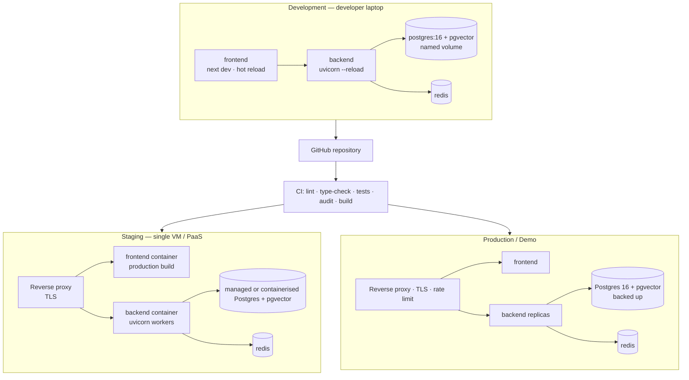

### 11.1 Development

| Aspect | Setup |
|---|---|
| Command | `docker compose up` brings up postgres, redis, backend, frontend |
| Frontend | `next dev` with hot module reload, source-mounted |
| Backend | `uvicorn --reload`, source-mounted, so Python changes restart automatically |
| Database | `postgres:16` with the pgvector extension, on a named volume so data survives container recreation |
| Migrations | Alembic runs on backend startup (or via a documented one-liner); the initial migration creates the pgvector extension |
| Configuration | `.env` derived from `.env.example`; every variable documented in the phase that introduced it |
| Seed/scripts | `scripts/` holds dev helpers: create test user, ingest the gold-standard test corpus, re-embed after a model change |
| Model weights | Embedding and cross-encoder weights cached in a volume so containers do not re-download on every start |

### 11.2 Staging

Staging exists to rehearse production, particularly the demo. It runs the **production images** with production settings and non-production data.

| Aspect | Setup |
|---|---|
| Topology | Same compose topology as production, smaller resources |
| Images | Production multi-stage builds — no source mounts, no reload |
| Configuration | Separate `.env`, separate database, separate LLM API keys where quotas allow |
| TLS | Terminated at the reverse proxy |
| Purpose | Verify migrations apply cleanly against a fresh database, verify the full user journey end-to-end, rehearse the demo script, run the load test |

### 11.3 Production

For this project, "production" is the demo deployment: a single cloud VM or a PaaS such as Railway or Render, as specified in the master prompt.

| Aspect | Setup |
|---|---|
| Target | Single VM with Docker Compose, or Railway/Render, or a university-provided VM |
| Ingress | Reverse proxy handling TLS, security headers, and a coarse request-rate limit ahead of the application |
| Backend | Production `uvicorn` with multiple workers; no `--reload`; docs endpoints disabled or protected |
| Frontend | Production Next.js build, static assets content-hashed and long-cached |
| Database | PostgreSQL 16 with pgvector, on a persistent volume, with automated daily backups (pg_dump to cloud storage, 7-day retention) and monthly restore verification |
| Redis | Single instance; cache loss is tolerable by design |
| Secrets | Injected as environment variables by the platform; never baked into images |
| Monitoring | Structured logs + health-check endpoints + Prometheus metrics (request latency, error rates, queue depth) + Grafana dashboards + alerting on error rates > 1% or latency > SLA |
| Observability | OpenTelemetry tracing for request → agent → tool → LLM call chain with correlation IDs |
| Release | Tagged `v1.0` in the repository |
| Demo readiness | Uptime rehearsed the day before defence; a rollback is redeploying the previous tagged image |

### 11.4 Docker

| Image | Build strategy |
|---|---|
| `backend` | Multi-stage: dependency install layer, then a slim runtime layer. Non-root user. Includes the OCR toolchain (`tesseract`) and any PDF/export system dependencies. Health-check defined. |
| `frontend` | Multi-stage: `deps` → `build` → minimal runtime serving the production build. Non-root user. |
| `postgres` | `postgres:16` with pgvector available; extension created by the initial Alembic migration. |
| `redis` | Official image, default configuration. |

Compose files: a base `docker-compose.yml` under `deployment/`, with an override for development (source mounts, reload, exposed ports) and an override for production (production commands, restart policies, no source mounts). Volumes persist database data and model weights. Dependency ordering uses health-check conditions so the backend does not start before Postgres accepts connections.

### 11.5 CI/CD

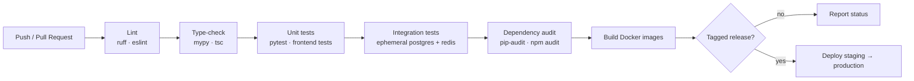

| Stage | Gate |
|---|---|
| Lint | `ruff` (Python), `eslint` (TypeScript) |
| Type-check | `mypy` on the backend, `tsc --noEmit` on the frontend |
| Unit tests | `pytest` for services and core logic; frontend component tests |
| Integration tests | Against ephemeral Postgres (with pgvector) and Redis containers; the full upload → query → report flow. **LLM providers are stubbed** — CI never spends API budget or depends on external availability. |
| Migration check | Alembic upgrades cleanly from empty to head |
| Audit | `pip-audit`, `npm audit`; findings resolved or documented |
| Build | Docker images built to catch build-time breakage before deploy |
| Deploy | Only from a tagged release; staging first, then production |

### 11.6 Cloud Deployment

Documented as a path, deliberately kept boring:

1. Provision a small VM (2 vCPU / 4 GB minimum, since embedding and cross-encoder inference are CPU-bound) or a PaaS project.
2. Install Docker and Compose; clone the repository.
3. Populate `.env` from `.env.example` with production secrets.
4. `docker compose -f deployment/docker-compose.yml -f deployment/docker-compose.prod.yml up -d`.
5. Point a domain at the host; issue TLS certificates at the reverse proxy.
6. Confirm each health endpoint; run the smoke journey (signup → upload → query → generate → export).
7. Schedule automated daily database backups (pg_dump to cloud storage with 7-day retention) and verify a restore at least once per month.

PaaS variant: deploy backend and frontend as separate services, attach a managed Postgres with pgvector and a managed Redis, and set environment variables in the platform dashboard. The application requires no code change — the only difference is where the database URL points.

---

## 12. Folder Structure

```
aegis-research-os/
├── frontend/                        # Next.js 14 (App Router) + TypeScript
│   ├── app/                         # Routes; folder = route segment
│   │   ├── (marketing)/             # Public landing page
│   │   ├── (auth)/                  # /login, /register — auth shell layout
│   │   ├── (workspace)/             # Authenticated area — persistent shell
│   │   │   ├── dashboard/           # Project list + create
│   │   │   └── projects/[id]/       # Chat · documents · reports · graph · settings
│   │   ├── layout.tsx               # Root layout: theme, fonts, providers
│   │   └── globals.css              # Tailwind entry + CSS custom-property themes
│   ├── components/
│   │   ├── ui/                      # shadcn/ui primitives (owned in-repo, themeable)
│   │   ├── layout/                  # AppShell · SideNav · TopBar · ThemeToggle
│   │   ├── auth/ projects/ documents/ chat/ trace/ generate/ reports/ graph/
│   │   └── feedback/                # EmptyState · LoadingSkeleton · ErrorState · Toaster
│   ├── lib/
│   │   ├── api/                     # Typed API client; one module per resource
│   │   ├── hooks/                   # Reusable hooks (auth, streaming run, polling)
│   │   └── utils/                   # Formatting, class merging, citation rendering
│   ├── types/                       # Shared TS types mirroring backend schemas
│   ├── public/                      # Static assets
│   ├── tests/                       # Component and flow tests
│   └── package.json
│
├── backend/                         # FastAPI (Python 3.11+)
│   ├── app/
│   │   ├── api/                     # Routers only — thin controllers
│   │   │   ├── deps.py              # Shared dependencies: current_user, project scope, db
│   │   │   └── v1/                  # auth · projects · documents · query · traces · reports · health
│   │   ├── agents/                  # LangGraph multi-agent layer
│   │   │   ├── graph.py             # Graph construction, edges, retry policy
│   │   │   ├── state.py             # AgentRunState (typed shared state)
│   │   │   ├── nodes/               # One module per agent: supervisor, retrieval, summarizer,
│   │   │   │                        #   fact_checker, synthesis, memory, critic
│   │   │   ├── prompts/             # Prompt templates, versioned, kept out of code
│   │   │   └── tools/               # Tool registry + typed tool implementations
│   │   ├── core/                    # Cross-cutting infrastructure
│   │   │   ├── config.py            # Pydantic settings — the only place env vars are read
│   │   │   ├── security.py          # Hashing, token issue/verify
│   │   │   ├── llm/                 # LLMProvider protocol + openai/gemini/sambanova impls
│   │   │   ├── cache.py             # Typed Redis helpers
│   │   │   ├── logging.py           # Structured logging setup, correlation IDs
│   │   │   ├── errors.py            # Exception hierarchy
│   │   │   └── envelope.py          # Uniform response envelope helpers
│   │   ├── db/
│   │   │   ├── models/              # SQLAlchemy 2.0 models, one module per aggregate
│   │   │   ├── repositories/        # Query objects; the only place raw SQL is allowed
│   │   │   ├── session.py           # Async engine + session dependency
│   │   │   └── migrations/          # Alembic environment + versioned migrations
│   │   ├── schemas/                 # Pydantic v2 request/response models
│   │   ├── services/                # Business logic
│   │   │   ├── auth.py projects.py
│   │   │   ├── ingestion/           # extract · ocr · metadata · chunk · pipeline
│   │   │   ├── embeddings.py
│   │   │   ├── retrieval/           # vector · fts · fusion · rerank · context assembly
│   │   │   ├── external/            # arxiv · semantic_scholar · core · crossref · web_search
│   │   │   ├── memory.py
│   │   │   ├── reports.py export/   # artifact persistence; pdf · docx · latex renderers
│   │   │   ├── graph.py             # stretch — Phase 7
│   │   │   └── analytics/           # stretch — Phase 8, includes the sandbox runner
│   │   ├── workers/                 # Background job definitions (ingestion, agent runs)
│   │   └── main.py                  # App factory: routers, middleware, exception handlers
│   ├── tests/
│   │   ├── unit/                    # Services, core logic, fusion arithmetic, prompts
│   │   ├── integration/             # Full flows against ephemeral Postgres + Redis
│   │   ├── evaluation/              # Gold-standard set + precision@k / citation-accuracy harness
│   │   └── conftest.py              # Fixtures, stubbed LLMProvider
│   ├── pyproject.toml
│   └── alembic.ini
│
├── docs/                            # Project documentation and report material
│   ├── architecture.md              # Architecture + Mermaid diagrams (Phase 0)
│   ├── db-schema.md                 # ERD + table definitions (Phase 0)
│   ├── agents.md                    # Agent roster: purpose · IO · tier · tools (Phase 0)
│   ├── api-contract.md              # Endpoint list + envelope conventions (Phase 0)
│   ├── design.md                    # This document
│   ├── adr/                         # Architecture Decision Records
│   ├── build-history.md             # Consolidated PHASE_LOG entries (Phase 11)
│   ├── evaluation.md                # Gold-set results, latency, cost analysis
│   └── report/                      # Major-project report drafts
│
├── deployment/
│   ├── docker-compose.yml           # Base topology
│   ├── docker-compose.dev.yml       # Source mounts, reload, exposed ports
│   ├── docker-compose.prod.yml      # Production commands, restart policies
│   ├── Dockerfile.backend           # Multi-stage, non-root, OCR + export toolchain
│   ├── Dockerfile.frontend          # Multi-stage, non-root
│   ├── proxy/                       # Reverse proxy config, TLS
│   └── .env.example                 # Every variable documented — the config contract
│
├── scripts/                         # dev-setup · seed-user · ingest-gold-set · re-embed · run-eval
├── .github/workflows/               # CI pipeline
├── PHASE_LOG.md                     # Per-phase build log (appended every phase)
├── .gitignore                       # Python + Node; .env must be listed
└── README.md                        # Setup, architecture overview, screenshots
```

**Why the structure looks like this**

| Directory | Purpose |
|---|---|
| `app/api` | The only layer that knows about HTTP. Swapping the transport would touch nothing else. |
| `app/agents` | Isolated so the agent graph can be tested with a stubbed provider and fixture state, with no HTTP or database involvement. |
| `app/core` | Infrastructure every layer may use but which depends on nothing above it — config, security, LLM abstraction, cache, logging, errors. |
| `app/db/repositories` | The single permitted home for raw SQL, including vector and FTS queries. Keeps the tenancy boundary auditable in one place. |
| `app/services` | All business logic, HTTP-free and therefore unit-testable. |
| `app/schemas` vs `app/db/models` | Wire contracts kept separate from persistence models, so a schema change is not automatically a database change. |
| `tests/evaluation` | Separated from correctness tests because it measures quality (precision@k, citation accuracy) rather than pass/fail — and produces numbers for the report. |
| `docs/adr` | Records *why* decisions were made (pgvector over ChromaDB, RRF over score normalisation, BackgroundTasks over Celery), which is exactly what the report's design chapter needs. |
| `deployment` | All deployment concerns in one directory so the root stays legible. |

---

## 13. Coding Standards

### 13.1 Naming Conventions

**Python (backend)**

| Element | Convention | Example |
|---|---|---|
| Modules, packages | `snake_case` | `retrieval/fusion.py` |
| Classes | `PascalCase` | `RetrievalService`, `OpenAIProvider` |
| Functions, variables | `snake_case` | `build_citation_map` |
| Constants | `UPPER_SNAKE_CASE` | `MAX_UPLOAD_BYTES` |
| Private helpers | Leading underscore | `_normalise_query` |
| Async functions | No prefix; `async def` is the signal | `async def complete(...)` |
| Pydantic schemas | Suffixed by role | `ProjectCreate`, `ProjectRead`, `QueryRequest` |
| SQLAlchemy models | Singular class, plural table | `class Document` → `documents` |
| Tests | `test_<unit>_<behaviour>` | `test_login_rejects_wrong_password` |

**TypeScript (frontend)**

| Element | Convention | Example |
|---|---|---|
| Components | `PascalCase` file and export | `CitationChip.tsx` |
| Hooks | `useX` | `useAgentRun` |
| Utilities | `camelCase` | `formatCitation` |
| Types, interfaces | `PascalCase`, no `I` prefix | `AgentTrace`, `DocumentStatus` |
| Route folders | lowercase, hyphenated | `app/projects/[id]/reports` |
| Constants | `UPPER_SNAKE_CASE` | `POLL_INTERVAL_MS` |

**Cross-cutting**

| Element | Convention |
|---|---|
| Database tables/columns | `snake_case`, plural tables |
| API paths | lowercase, plural nouns, hyphenated multi-word |
| JSON fields | `snake_case`, matching backend schemas exactly, so no translation layer is needed |
| Environment variables | `UPPER_SNAKE_CASE`, prefixed by domain (`LLM_PROVIDER`, `POSTGRES_URL`, `REDIS_URL`) |
| Error codes | `UPPER_SNAKE_CASE`, closed enum (`VALIDATION_ERROR`, `RATE_LIMITED`) |
| Agent names in traces | Fixed strings matching the roster exactly, since the UI and analytics group by them |
| Git branches | `phase-<n>-<slug>`, `fix/<slug>` |
| Commits | Conventional-style prefix (`feat:`, `fix:`, `docs:`, `test:`, `chore:`) |

### 13.2 Architecture Rules

Non-negotiable, because these are the rules that keep the system coherent as it grows:

1. **No provider SDK outside `core/llm`.** Agent and route code calls `LLMProvider.complete` only. This is the rule that makes provider swapping a config change.
2. **Every LLM call declares `model_tier` and `max_tokens`.** No defaults, no exceptions. Cost discipline is enforced by the signature.
3. **Dependencies point inward:** `api → services → repositories → core`. Nothing in `services` or below imports FastAPI request objects. `core` imports nothing from above it.
4. **Routers are thin.** Validate, authorise, delegate, envelope. No SQL, no prompts, no retrieval logic. If a handler grows past a screen, logic has leaked.
5. **Raw SQL lives only in repositories.** Vector and FTS queries included.
6. **Project scope is mandatory.** Any repository method touching project content requires `project_id`. There is no method that queries content across projects.
7. **Schema changes go through Alembic.** No `create_all` in application code.
8. **Wire schemas ≠ database models.** Pydantic schemas at the boundary, ORM models in persistence; conversion is explicit.
9. **Prompts live in `agents/prompts/`,** not inline in node code — so they can be reviewed, versioned, and diffed like the assets they are.
10. **Tools validate their arguments** with Pydantic before executing. Model output is untrusted input.
11. **Every agent node writes a trace** before yielding control.
12. **Markdown is the single source of truth for artifacts.** All export formats derive from it; none is edited independently.
13. **Placeholder honesty.** An unbuilt feature renders a labelled empty state. Never mock data that looks real.
14. **Frontend components own presentation, not business rules.** Retrieval, ranking, and citation logic live on the server, always.

### 13.3 Error Handling

| Rule | Detail |
|---|---|
| One hierarchy | Domain exceptions in `core/errors.py`, mapped centrally to status codes and envelope codes |
| No hand-built error responses | A global exception handler owns the shape |
| No bare `except:` | Catch specific exceptions; a broad catch must re-raise or log with full context |
| Fail loudly at boundaries | Invalid input is rejected outright with a precise message |
| Fail softly in the pipeline | A dead external API or a single failed agent node degrades the run; it does not abort it |
| Partial success is modelled | An agent run can complete with a failed node and a clearly marked partial result |
| Never leak internals | Stack traces and provider error bodies go to logs, correlated by `request_id` |
| Errors are actionable | Explain what happened and what the user can do — "OCR confidence was low; extracted text may be unreliable", not "processing failed" |
| Ingestion errors are recorded, not raised | The document moves to `failed` with a reason; the request already returned |
| Frontend mirrors backend states | Every documented error code has a corresponding UI state |

### 13.4 Logging Standards

| Rule | Detail |
|---|---|
| Structured JSON | One event per line; machine-parseable |
| Correlation | `request_id` on every request log; `run_id` on every agent log |
| Stable event names | `document.ingest.completed`, `agent.node.finished`, `llm.cache.hit` — treated as an interface, not prose |
| Level discipline | `DEBUG` local detail; `INFO` lifecycle events; `WARNING` degraded-but-handled (external API failure, low OCR confidence); `ERROR` failed operations; `CRITICAL` startup/config failures |
| Never log | Passwords, tokens, API keys, full document text, full prompt payloads |
| Measure at the source | `duration_ms`, `tokens_in`, `tokens_out`, `estimated_cost_usd` logged where they are produced |
| Distributed tracing | OpenTelemetry spans for request → agent → tool → LLM call chain; spans include correlation IDs and trace context propagation |
| Two channels, kept distinct | Operational logs to stdout (ephemeral, for ops); agent traces to the database (durable, user-facing, feeds the report) |
| No print statements | Always the configured logger |

### 13.5 Testing Strategy

Tests ship **with each phase**, never deferred. That is a stated project principle: a solo developer who defers all testing to Phase 11 arrives at week 11 with an unverifiable system.

| Level | Scope | Tooling |
|---|---|---|
| **Unit** | Services and core logic in isolation with stubbed collaborators: token issuance/verification, chunking boundaries, RRF arithmetic, citation-map construction and validation, envelope shaping, tier/budget enforcement | `pytest`, stubbed `LLMProvider` |
| **Integration** | Real Postgres (with pgvector) and Redis in ephemeral containers, LLM stubbed: register → login → create project → upload → poll to `ready` → query → cited answer → generate artifact → export | `pytest`, docker services |
| **Frontend** | Critical flows: auth, chat interaction, document upload; plus rendering of empty/loading/error states | Component/flow tests |
| **Evaluation** | The gold-standard set of 5–10 research questions with known good answers/sources. Measures retrieval precision@k and citation accuracy, and produces the numbers reported in the project report and viva | `tests/evaluation` harness |
| **Load** | The query endpoint under a realistic concurrent-user scenario, results recorded for the report | Load-testing tool of choice |

**Per-phase minimum:** unit tests for that phase's backend logic plus at least one integration test for its primary user flow. Phase-specific acceptance tests are mandatory, notably: the Critic agent must demonstrably catch a deliberately injected unsupported claim (Phase 5), a corrupt upload must produce a clean `failed` state rather than a crash (Phase 3), and generated answers must cite only retrieved chunks (Phase 4).

**Rules:** LLM providers are always stubbed in CI — tests must be deterministic and must not spend API budget. Tests assert behaviour, not implementation detail. Every bug fixed gets a regression test. Cross-tenant isolation has explicit tests asserting a 404.

### 13.6 Documentation Standards

| Artifact | Standard |
|---|---|
| `README.md` | Project description, prerequisites, setup, `docker compose up`, architecture overview, screenshots. Kept accurate every phase — the reproducibility criterion depends on it. |
| `.env.example` | Every variable, with a placeholder and a one-line comment. Updated in the same phase the variable is introduced. |
| `PHASE_LOG.md` | One entry per phase: what was built, key decisions, deviations from plan, new environment variables or setup steps. Consolidated into `docs/build-history.md` in Phase 11. |
| ADRs (`docs/adr/`) | One short record per significant decision: context, options, decision, consequences. Feeds the report's design-justification sections directly. |
| Phase 0 design docs | `architecture.md`, `db-schema.md`, `agents.md`, `api-contract.md` — kept internally consistent; table names in the schema doc must match those referenced in the API and agent docs. |
| Docstrings | Public services, agent nodes, and tools document purpose, inputs, outputs, and failure modes. Types carry the rest — no restating signatures in prose. |
| Comments | Explain *why*, not *what*. Non-obvious trade-offs (RRF choice, ANN recall behaviour, retry cap) get a comment. |
| API documentation | Generated from FastAPI/Pydantic schemas; the full reference is an appendix in the report. |
| Prompts | Versioned files in `agents/prompts/` with a header noting the agent, tier, and expected output shape. |
| Report mapping | Documentation is written per phase and mapped to the structure in `05_project_report_outline.md`, so the report is assembled rather than written from scratch at the end. |

---

## 14. UI/UX Principles

### 14.1 Visual Language

The product is a research instrument, so the interface behaves like one: quiet chrome, high-contrast content, and generous space around text that is meant to be read closely. Three ideas drive every visual decision.

**Content is the interface.** Retrieved evidence, generated prose, and citations are the product. Navigation and controls recede — neutral surfaces, restrained colour, no decorative gradients competing with a literature review.

**Trust is visible.** Every mechanism that makes the output trustworthy has a visual presence: citation chips that open their source, verification states on claims, an agent trace showing the work. A user who cannot check the system will not trust it, and the interface's main job is to make checking easy.

**Density with air.** Researchers work with long lists (documents, sources, trace steps) and long prose (artifacts). Lists are compact and scannable; prose is spacious and constrained to a readable measure. The same page can do both because the two modes are visually distinct.

### 14.2 Consistency

| Dimension | Rule |
|---|---|
| One component per job | One button component, one dialog, one toast, one empty state, one skeleton. Variants, never forks. |
| Tokens, not values | Components reference semantic tokens; no raw hex, no ad-hoc spacing. |
| Status colours are fixed | The mapping in [§5.6](#56-colour-palette) holds everywhere. `success` always means the same thing. |
| One async pattern | Start → identifier → observe progress → terminal state. Ingestion and agent runs behave identically, so the user learns it once. |
| Predictable placement | Primary action top-right of a section; destructive actions in overflow menus behind confirmation; filters above lists. |
| Consistent copy voice | Plain, specific, non-apologetic. "No documents yet" not "Oops, nothing here!" |
| Icon + text for status | Never colour alone — an accessibility requirement and a clarity one. |

### 14.3 User Flows

**Primary journey — the flow the demo and the report walk through:**

```mermaid
flowchart LR
    L[Landing] --> R[Register]
    R --> D[Dashboard]
    D --> CP[Create project]
    CP --> W[Workspace]
    W --> UP[Upload documents]
    UP --> PR[Watch processing → ready]
    PR --> Q[Ask a research question]
    Q --> A[Cited answer + trace]
    A --> G[Generate literature review]
    G --> V[Read artifact with citations]
    V --> E[Export PDF / DOCX / LaTeX]
```

**Supporting flows**

| Flow | Shape |
|---|---|
| Returning user | Login → dashboard → open recent project → continue in Chat, with prior conversation and project memory intact |
| Verify a claim | Read answer → click citation chip → source chunk opens with page/section → confidence established or doubt raised |
| Inspect reasoning | Expand the Reasoning Trace → see agent sequence with tokens, latency, cost → understand *how* the answer was produced |
| Compare sources | Generate panel → Comparison → select 2+ documents → structured table of methodology, findings, limitations |
| Recover from a failed upload | Failed badge → open document → read the specific reason → replace or remove the file |
| Handle a flagged artifact | Critic flags an unsupported claim → warning notice on the artifact → user inspects and decides |

Design constraints on flows: no dead ends (every terminal state offers a next action), no unexplained waiting (progress is always attributable to a named step), and no destructive action without confirmation.

### 14.4 Empty States

Empty states are onboarding, not apology. Each explains what belongs here, why it matters, and offers the single action that fills it.

| Surface | Content |
|---|---|
| Dashboard, no projects | What a project is (a research workspace with its own documents and memory) + Create Project |
| Documents, none uploaded | What formats are accepted and what happens after upload + the dropzone as the focal element |
| Chat, no messages | Two or three example research questions, phrased to demonstrate the multi-part requests the agent pipeline handles well |
| Reports, none generated | The four artifact types explained in one line each + a link to the Generate panel |
| Trace panel, no run yet | One line explaining that agent steps will appear here during a run |
| Knowledge Graph / Analytics (pre-stretch) | Clearly labelled "coming soon" — a stated requirement: no fabricated data, ever |
| Search/filter, no matches | Distinguished from "nothing exists yet", with a clear-filters action |

### 14.5 Loading States

Waiting is unavoidable in this product — retrieval, model calls, and multi-agent runs all take real time. The design principle is that waiting must be **legible**: the user should always know what is happening and roughly how far along it is.

| Duration | Treatment |
|---|---|
| < 300 ms | No indicator — a flash of spinner is worse than nothing |
| 300 ms – 2 s | Inline spinner on the triggering control, which becomes disabled |
| 2 s – 10 s | Skeleton matching the real content's geometry, so nothing shifts on arrival |
| 10 s – 2 min | **Named progress.** Document ingestion shows its pipeline stage; an agent run shows live trace steps as agents complete. This is where the trace panel earns its keep — a two-minute wait with visible progress reads as thorough, while a two-minute spinner reads as broken. |
| Streaming | Answers render token by token so the user starts reading before generation finishes |

Skeletons mirror final layout exactly (a requirement: no layout shift between empty, loading, and populated). Optimistic updates apply only where rollback is trivial — project creation, document deletion.

### 14.6 Error States

| Kind | Treatment |
|---|---|
| Field validation | Inline, beneath the field, on blur or submit; associated programmatically for screen readers |
| Action failure (toast) | Transient failures on a user-initiated action, with retry where retry is meaningful |
| Section failure | Inline error panel inside the failed region, with a retry action; the rest of the page stays usable |
| Resource failure | A failed document shows a `destructive` badge and, on open, the specific reason plus replace/remove actions |
| Partial run failure | The answer is shown with a clear notice that a step failed, and the failed step is visible in the trace |
| Degraded quality | Low OCR confidence and Critic-flagged claims use `warning` tone — the result is usable but qualified |
| Rate limited | Explains the limit and when to retry, rather than a bare 429 |
| Auth expiry | Silent refresh where possible; otherwise redirect to login preserving the return path |
| Unexpected error | Friendly message plus the `request_id`, so a report can be correlated to logs. No stack traces. |

Every error answers: what failed, why (in the user's terms), and what to do next.

### 14.7 Animations

Motion clarifies spatial relationships and state changes. It never decorates and never delays.

| Element | Motion |
|---|---|
| Route/tab change | Brief content cross-fade; the persistent shell does not move |
| Modal / dialog | Scale + fade from centre, backdrop fade |
| Trace panel | Slide from the right rail (bottom sheet on mobile), interruptible |
| Trace step arrival | New step fades and slides in a few pixels — the run feels alive without flicker |
| Streaming text | Characters append with no per-character animation; a subtle cursor indicates ongoing generation |
| Toast | Slide in, auto-dismiss, slide out |
| Skeleton | Gentle shimmer, low contrast |
| Accordion / collapse | Height transition with matching opacity |
| Graph (stretch) | Smooth pan/zoom; layout settles rather than snapping |

Rules: durations in the 150–300 ms range for UI transitions; `ease-out` for entrances and `ease-in` for exits; nothing animates in a way that blocks input; everything respects `prefers-reduced-motion` by degrading to instant state changes. Framer Motion handles the interruptible cases.

### 14.8 Micro-interactions

Small responses that make the interface feel accountable:

| Interaction | Response |
|---|---|
| Citation chip hover | Popover previews the source snippet with its document and page — verification without leaving the flow |
| Dropzone drag-over | Border and background shift to `accent`; the drop target is unmistakable |
| Upload progress | Per-file progress, then a status badge that transitions in place through the pipeline |
| Copy action | Icon morphs to a check and reverts after a moment |
| Theme toggle | Icon crossfades; colours transition rather than snapping |
| Agent step completion | Step icon settles from active to `success` with a token/latency/cost readout appearing beside it |
| Destructive hover | Control shifts to `destructive` tone before the confirmation dialog appears |
| Form submit | Button enters a loading state in place, retaining its width so nothing reflows |
| Long list scroll | Sticky section headers keep context while scanning documents or trace steps |
| Focus | Visible `ring` on every focusable element — a functional micro-interaction, not a decorative one |

---

## 15. Future Enhancements

Everything here is deliberately **outside the MVP**. Items 15.1–15.4 are the defined stretch phases with acceptance criteria already written; 15.5 is genuine future work beyond the project's planned scope.

### 15.1 Knowledge Graph (Phase 7)

Visual exploration of relationships between papers, authors, topics, and institutions across a project's documents and retrieved sources.

- Entity extraction (authors, topics, institutions) during document processing and from agent retrieval results.
- Relationship modelling: co-authorship, citation, topic-membership.
- **Relational first.** Nodes and edges as PostgreSQL tables, not Neo4j — introducing Neo4j is only justified if its setup is already validated and there is spare time budget.
- Interactive visualisation (react-flow or cytoscape.js) in a Knowledge Graph tab, with node-type filtering and click-to-inspect linking back to source documents.
- Acceptance: for a project with 5+ documents, the graph renders a non-trivial network including authors, topics, and citation edges.

### 15.2 Analytics & Data Science (Phase 8)

AI-assisted statistical analysis over user-uploaded CSV datasets.

- CSV upload with pandas-based profiling: column types, summary statistics.
- Natural-language questions about the data, answered with generated analysis.
- Chart generation (matplotlib/plotly) returned as images or interactive configs, with a plain-language explanation.
- **Sandboxed execution is the hard requirement.** AI-generated analysis code runs resource-limited and isolated; filesystem access attempts and infinite loops must be contained or rejected. This is the highest-risk feature in the entire plan and is explicitly gated behind a security review.

### 15.3 Report Polish & Export (Phase 9)

Partially in the MVP (Markdown → export exists for the demo journey); Phase 9 is where fidelity is finished.

- Markdown → PDF (WeasyPrint or headless-browser print), DOCX (`python-docx` mapped to Word styles), LaTeX (template-based, pandoc acceptable) producing a compilable `.tex`.
- Executive summary generator condensing a full report to roughly one page.
- Reports tab with re-export in any format.
- Acceptance: every format opens correctly in its native viewer with headings, citations, and tables preserved.

### 15.4 Enterprise / Collaboration (Phase 10)

- Team/organisation model: invite users to a project with owner/editor/viewer roles.
- Activity history: audit log of uploads, queries, and report generation per project.
- Notifications when a long-running generation completes.
- Per-project cost/usage dashboard (tokens, estimated cost, query count), built from `agent_traces` data already logged since Phase 5 — a good example of observability paying off twice.

### 15.5 Additional Agents & Beyond-Scope Work

Defined in the source plan as optional agents, plus work identified during design but outside the project's committed scope:

| Enhancement | Notes |
|---|---|
| Dataset/Code Search agent | Kaggle API, Hugging Face Datasets API — pairs naturally with Phase 8 |
| Debate agent | Adversarial multi-perspective analysis of contested findings |
| Trend / Gap-Analysis agent | Deeper temporal and thematic gap analysis than the Phase 6 feature |
| Hypothesis-Generation agent | Novel hypothesis proposals grounded in identified gaps |
| Durable task queue | `arq` or Celery, replacing `BackgroundTasks` for restart-safe jobs |
| Dedicated inference service | Extract embedding and cross-encoder inference from the API process |
| Token denylist for revocation | Redis-backed, closing the documented "access tokens cannot be revoked early" gap |
| Column-level encryption | Application-level encryption of document content at rest |
| Additional input formats | HTML, LaTeX source, plain text, EPUB ingestion |
| Citation style selection | IEEE / APA / MLA output formatting |
| Reference manager integration | Zotero/Mendeley import |
| Multilingual retrieval | Enabled by swapping in the stronger multilingual embedding model already contemplated in the design |
| Read replicas | Scale retrieval-heavy load |

---

## 16. Risks & Mitigations

### 16.1 Scope & Delivery Risks

| # | Risk | Impact | Likelihood | Mitigation |
|---|---|---|---|---|
| R1 | **Scope overrun.** The original plan is a 3–5 engineer, 6-month effort compressed into 12–14 solo weeks. Unchecked, it ends as a half-finished product — which evaluates worse than a smaller, fully working one. | Critical | High | Hard MVP cut-line at Phases 0–6. Phases 7–10 are stretch and gated behind an explicit MVP checkpoint. 15 agents consolidated to 7. The checkpoint is a stop-and-harden gate, not a formality. |
| R2 | **Deferred testing.** Saving all tests for Phase 11 leaves an unverifiable system at week 11. | High | High | Tests ship per phase as an acceptance condition. Integration test for each phase's primary flow. CI gates on every push. |
| R3 | **Demo failure.** The system works locally but not in the demo environment. | Critical | Medium | `docker compose up` reproducibility enforced every phase. Staging runs production images. Full journey rehearsed and uptime verified the day before defence. Tagged release enables instant rollback. |
| R4 | **Polish debt.** Functionality complete, presentation poor — costly for a portfolio and viva. | Medium | Medium | Phase 2 front-loads the UI/UX pass; every subsequent phase must be demoable in the UI, not merely present in the API. |
| R5 | **Report written last.** Documentation compressed into the final days produces a weak report. | High | Medium | `PHASE_LOG.md` per phase, ADRs at decision time, docs mapped to `05_project_report_outline.md` from Phase 0. The report is assembled, not authored from zero. |

### 16.2 Technical Risks

| # | Risk | Impact | Likelihood | Mitigation |
|---|---|---|---|---|
| R6 | **LLM hallucination — fabricated citations.** The single most damaging failure for a research tool; one fake citation in a viva undermines the whole project. | Critical | High | Layered defence: citation map built before generation, mandatory post-generation validation that every marker resolves to a retrieved chunk, Fact-Checker agent verifying claim↔source support, Critic agent as final QA, and clickable citations so the examiner can verify live. Acceptance test asserts no citation outside the retrieval set. |
| R7 | **API cost blowout.** Many agents × many LLM calls exhausts budget quickly. | High | High | Tiered routing (`fast` for volume work, `strong` only for judgement), mandatory `max_tokens` per call, Redis response caching, external-API caching, per-call cost logging so spend is visible before it becomes a surprise. |
| R8 | **Operational overhead from too much infrastructure.** Five services (Postgres, ChromaDB, Neo4j, Redis, Celery) is unmanageable solo. | High | High (if unaddressed) | pgvector replaces ChromaDB; Neo4j deferred and modelled relationally; Celery replaced by `BackgroundTasks`. MVP infra = Postgres + Redis + FastAPI + Next.js. |
| R9 | **Poor retrieval quality.** Vector-only search misses exact terms; approximate indexes miss results. | High | Medium | Hybrid retrieval where the keyword path hedges the vector path's approximation; RRF fusion needing no per-corpus tuning; optional cross-encoder re-ranking; gold-standard set to measure rather than assume quality. |
| R10 | **Garbage in from scanned PDFs.** Silent OCR failure produces confidently wrong answers. | High | Medium | OCR confidence flagged, never silently accepted; flag visible in the UI and carried into citations from that document; corrupt files fail cleanly with a stated reason. |
| R11 | **Agent orchestration instability.** Loops, non-terminating plans, runaway cost. | High | Medium | Critic retry capped at one, enforced in state rather than in a prompt; per-node token budgets; timeouts; graceful degradation to partial results; every step traced so a misbehaving run is diagnosable. |
| R12 | **External API unreliability.** arXiv, Semantic Scholar, CORE, CrossRef, or the web search provider is down, rate-limited, or changes shape. | Medium | High | Connectors fail soft with a trace warning; the run continues on remaining sources; results normalised behind one internal shape so a provider change is contained; caching reduces call volume. |
| R13 | **Latency exceeding targets** (< 8 s simple query, < 2 min multi-agent). | Medium | Medium | Streaming responses; parallel independent subtasks; `fast`-tier for volume work; re-ranking toggleable; bounded candidate sets; caching. Latency measured against the gold set, not assumed. |
| R14 | **Embedding model drift.** Changing the embedding model silently invalidates every stored vector. | High | Low | Model identifier stored so mismatch is detectable; re-embed script in `scripts/`; treated as a migration event. |
| R15 | **Sandbox escape (Phase 8).** AI-generated code executing with host access. | Critical | Medium | Feature is stretch and gated behind an explicit security review. Resource-limited isolated execution, rejection of filesystem/network access, mandatory acceptance test with deliberately hostile code. If the sandbox cannot be made convincing, the feature is dropped — this is the correct trade. |
| R16 | **Prompt injection via uploaded documents.** A document contains text crafted to look like instructions. | Medium | Medium | Retrieved content is framed strictly as evidence to cite, never as directives; tool arguments Pydantic-validated before execution; no tool fetches user-supplied URLs; Critic reviews output for anomalies. |
| R17 | **Cross-tenant data leakage.** A query returns another user's chunks. | Critical | Low | `project_id` required by every content repository method; scope authorised as a dependency before handler execution; unauthorised access returns 404; explicit isolation tests. |
| R18 | **Background job loss on restart.** `BackgroundTasks` is not durable. | Medium | Medium | Jobs idempotent and status-observable from the database, so a stuck job is visible and re-runnable; documented limitation with `arq` as the identified upgrade path. |
| R19 | **Provider lock-in or availability loss.** A single LLM provider becomes unavailable or unaffordable. | Medium | Medium | `LLMProvider` abstraction with three implementations; switching is an environment-variable change. |
| R20 | **Export fidelity loss.** Headings, tables, or citations break in PDF/DOCX/LaTeX. | Medium | Medium | Markdown as single source of truth; per-format acceptance test requiring the output to open correctly in its native viewer. |

---

## 17. Assumptions

Assumptions made while producing this design. Each is stated so it can be challenged, and several are load-bearing.

### 17.1 Team, Timeline & Scope

| # | Assumption |
|---|---|
| A1 | A single developer builds the entire system. Every simplification decision follows from this. |
| A2 | ~10–11 weeks yields a strong MVP (Phases 0–6); ~16 weeks yields the full stretch scope. Phases 7–10 may legitimately be delivered as "not completed", documented honestly in the report. |
| A3 | Evaluation rewards a smaller, fully working, well-demonstrated system over a larger unfinished one. This is the premise behind the MVP cut-line. |
| A4 | Phases are executed in order; each assumes the previous phase's deliverables exist. |
| A5 | The developer is also the primary user, so requirements can be validated directly without external user research. |

### 17.2 Technology

| # | Assumption |
|---|---|
| A6 | The declared stack is fixed unless a deviation is explicitly justified: Next.js 14 App Router + TypeScript + Tailwind + shadcn/ui + Framer Motion; FastAPI (Python 3.11+) + SQLAlchemy 2.0 + Alembic + Pydantic v2; PostgreSQL 16 + pgvector; Redis; LangGraph. |
| A7 | pgvector performs adequately for project-scale corpora (tens of documents, thousands of chunks). A dedicated vector database is unnecessary at this scale. |
| A8 | Postgres full-text search is an acceptable substitute for a dedicated BM25 engine as the keyword half of hybrid retrieval. |
| A9 | Reciprocal rank fusion is preferable to score normalisation because cosine similarity and `ts_rank` are not comparably scaled and normalisation would need per-corpus tuning. |
| A10 | Sentence-transformers embedding and cross-encoder re-ranking run acceptably on CPU inside the backend container for this workload. |
| A11 | FastAPI `BackgroundTasks` suffices for MVP asynchronous work; durability across restarts is not an MVP requirement. |
| A12 | LangGraph is stable enough to express the agent graph, including a bounded conditional retry edge. |
| A13 | At least one of OpenAI, Gemini, or SambaNova is reachable and funded, and each can serve both a `fast` and a `strong` tier. |
| A14 | Docker and Docker Compose are available in every environment the project runs in. |

### 17.3 Data & External Services

| # | Assumption |
|---|---|
| A15 | Uploaded documents are predominantly research papers and reports in PDF or DOCX. Other formats are out of MVP scope. |
| A16 | Most PDFs contain extractable text; scanned documents are the minority, and OCR is a fallback rather than the primary path. |
| A17 | arXiv, Semantic Scholar, CORE, and CrossRef remain free to access (no key or free-tier key) with stable enough response shapes for a semester-length project. |
| A18 | A web search provider (Tavily or SerpAPI) free tier is sufficient for demonstration-level query volume. |
| A19 | Metadata extraction is heuristic and imperfect. Titles and authors are best-effort, presented as such, and correctable via CrossRef lookup where a DOI or exact title exists. |
| A20 | Users hold the rights to the documents they upload; the system does not verify licensing or copyright. |
| A21 | Typical project size is tens of documents, not thousands — this bounds indexing, latency, and cost assumptions. |

### 17.4 Users & Usage

| # | Assumption |
|---|---|
| A22 | Users are technically comfortable researchers who understand what an AI assistant can and cannot do, and who value visible citations over polished-sounding prose. |
| A23 | Users accept multi-minute waits for high-value artifacts, provided progress is legible. This assumption is what justifies the Reasoning Trace panel as a core feature rather than a debug tool. |
| A24 | Users work in English for the MVP; multilingual support is a model swap, deferred. |
| A25 | Single-user projects are the MVP norm; collaboration is genuinely stretch scope, not a hidden requirement. |
| A26 | Concurrency is low — demo and small-group scale, not public traffic. |
| A27 | Users work in modern evergreen browsers; legacy browser support is out of scope. |

### 17.5 Operations & Security

| # | Assumption |
|---|---|
| A28 | The deployment target is a single cloud VM or a PaaS (Railway/Render) or a university-provided VM. Kubernetes and multi-region are out of scope. |
| A29 | Short-lived access tokens make the absence of token revocation an acceptable MVP trade-off, documented rather than hidden. |
| A30 | Host/volume-level disk encryption is adequate at rest; application-level column encryption is future work. |
| A31 | Structured logs, health endpoints, and OpenTelemetry tracing provide adequate observability; a full metrics stack (Prometheus/Grafana) is recommended for production but optional for MVP. |
| A32 | Environment variables are an acceptable secrets mechanism; a dedicated secrets manager is out of scope. |
| A33 | Redis unavailability degrading rate limiting to permissive (with a logged warning) is the right availability trade-off for a demo-critical system. |
| A34 | Returning 404 for unauthorised project access is acceptable API behaviour, preferred over 403 because it does not disclose resource existence. |
| A35 | WCAG 2.1 AA is the working target. Automated checks and manual keyboard testing are in scope; full conformance validation with assistive technologies and expert review is not claimed. |

### 17.6 Design Resolutions

Where the source documents differed, the more detailed specification was taken. Recorded here for traceability:

| # | Resolution |
|---|---|
| A36 | **Agents: 7, not 15.** The consolidated roster in `01_analysis_and_improvements.md` and `04_architecture_and_specs.md` supersedes the original 15-agent concept; the remaining four are optional stretch additions. |
| A37 | **Vector store: pgvector, not ChromaDB.** The infrastructure-simplification decision is explicit and repeated across the source documents. |
| A38 | **Graph: relational, not Neo4j,** unless Neo4j setup is already validated with spare time budget. |
| A39 | **Queue: `BackgroundTasks` for the MVP,** with `arq` (Celery only if genuinely needed) as the stretch upgrade. |
| A40 | **Timeline: the revised solo estimates** (~10.5 weeks to MVP checkpoint, ~16 weeks full), not the original schedule. |
| A41 | **Export scope:** Markdown → PDF/DOCX/LaTeX is exercised for the MVP demo journey (Phase 6 acceptance requires an exportable artifact); Phase 9 completes fidelity and adds the Reports tab and executive summary. |
| A42 | **Trend analysis and hypothesis generation** are stretch *within* Phase 6 and never block the MVP checkpoint. |
| A43 | **`run_id`** is carried on `agent_traces` in addition to `message_id`, because `GET /projects/{id}/traces/{run_id}` must return a live run before the assistant message exists. This is an additive reconciliation of the API contract with the schema, not a new feature. |
| A44 | **`project_id` is denormalised onto `document_chunks`** so project-scoped vector and FTS queries filter without a join. A read-path optimisation consistent with the stated scoping requirement. |
| A45 | **Project memory is a persisted table**, since the Memory agent must maintain project-level long-term context across sessions and its facts must retain citations to stay verifiable. |

---

## Appendix A — Phase-to-Requirement Traceability

| Phase | Delivers | Key acceptance gate |
|---|---|---|
| 0 — Planning | `architecture.md`, `db-schema.md`, `agents.md`, `api-contract.md`, repo scaffold | Docs internally consistent; empty Next.js and FastAPI apps both start |
| 1 — Foundation | FR-A, FR-B; auth + projects + compose stack | `docker compose up`; register → login → create project → open workspace; 3 backend tests + 1 frontend smoke test |
| 2 — UI/UX | Landing, dashboard, workspace shell, chat shell, dark mode, skeletons, toasts, responsive | Every screen correct at desktop and mobile; both themes intentional; no layout shift across empty/loading/populated |
| 3 — Document Intelligence | FR-C | Real multi-page PDF produces chunks with embeddings; status transitions correct; corrupt file fails gracefully |
| 4 — Hybrid RAG | FR-D | Gold-standard set built; retrieval precision reported; no hallucinated citations |
| 5 — Multi-Agent System | FR-E | Multi-part question triggers multiple agents in the trace; cites internal + external sources; Critic catches an injected unsupported claim |
| 6 — Research Intelligence | FR-F | Literature review over 5+ documents, coherent and correctly cited, within the time budget → **MVP checkpoint** |
| 7 — Knowledge Graph (stretch) | FR-H1–H2 | Non-trivial graph for a 5+ document project; node inspection links to sources |
| 8 — Analytics (stretch) | FR-H3–H5 | Correct chart + explanation; hostile code contained or rejected |
| 9 — Reports & Export | FR-G | Every format opens correctly with headings, citations, tables preserved |
| 10 — Enterprise (stretch) | FR-H6–H9 | Invited viewer blocked from upload/delete; activity log correct |
| 11 — Testing, Security, Deployment | NFR-P6, NFR-S1–S6, NFR-M5 | Fresh clone + README only → running app, no undocumented steps; `v1.0` tagged |

## Appendix B — Configuration Contract

Every variable below belongs in `deployment/.env.example`, documented in the phase that introduces it.

| Variable | Phase | Purpose |
|---|---|---|
| `POSTGRES_URL` | 1 | Database connection |
| `REDIS_URL` | 1 | Cache, rate limiting, run status |
| `JWT_SECRET`, `JWT_ACCESS_TTL`, `JWT_REFRESH_TTL` | 1 | Token signing and lifetimes |
| `CORS_ORIGINS` | 1 | Allowed frontend origins |
| `NEXT_PUBLIC_API_URL` | 1 | Frontend → backend base URL (non-sensitive) |
| `MAX_UPLOAD_BYTES`, `ALLOWED_UPLOAD_TYPES` | 3 | Upload validation |
| `EMBEDDING_MODEL` | 3 | Sentence-transformers model id (stored for drift detection) |
| `CHUNK_TOKENS`, `CHUNK_OVERLAP_TOKENS` | 3 | Chunking parameters |
| `OCR_ENABLED`, `OCR_CONFIDENCE_THRESHOLD` | 3 | OCR fallback and flagging |
| `RERANK_ENABLED`, `RERANK_MODEL` | 4 | Cross-encoder re-ranking toggle and model |
| `RETRIEVAL_TOP_K`, `RETRIEVAL_TOP_N`, `RRF_K` | 4 | Retrieval and fusion parameters |
| `LLM_PROVIDER` | 4 | `openai` \| `gemini` \| `sambanova` |
| `OPENAI_API_KEY`, `GEMINI_API_KEY`, `SAMBANOVA_API_KEY` | 4 | Provider credentials (backend only) |
| `LLM_FAST_MODEL`, `LLM_STRONG_MODEL` | 4 | Tier → model mapping for the active provider |
| `LLM_CACHE_TTL` | 4 | Response cache lifetime |
| `SEMANTIC_SCHOLAR_API_KEY`, `CORE_API_KEY` | 5 | Academic API keys where required |
| `TAVILY_API_KEY` / `SERPAPI_API_KEY` | 5 | Web search provider |
| `EXTERNAL_CACHE_TTL` | 5 | External source cache lifetime |
| `AGENT_MAX_RETRIES` | 5 | Critic retry cap (1) |
| `RATE_LIMIT_AUTH`, `RATE_LIMIT_QUERY`, `RATE_LIMIT_REPORT` | 11 | Rate-limit windows |
| `LOG_LEVEL` | 11 | Logging verbosity |
| `ENVIRONMENT` | 11 | `development` \| `staging` \| `production` (gates docs exposure, TLS assumptions) |
