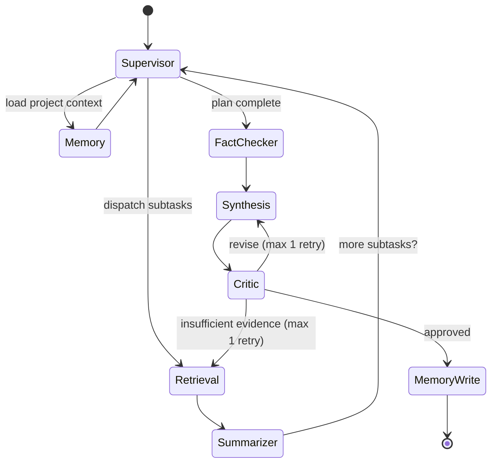

# Agent Roster — Aegis Research OS

Authoritative reference: [`design.md` §4](../design.md). Table names match
[`db-schema.md`](./db-schema.md); endpoints match [`api-contract.md`](./api-contract.md).

Seven core agents, implemented as LangGraph nodes over a shared typed
`AgentRunState`. Every LLM call goes through `LLMProvider.complete` with an explicit
`model_tier` and `max_tokens`; every node writes one `agent_traces` row before
yielding control.

## Core roster (Phase 5)

### 1. Supervisor / Planner

| | |
| --- | --- |
| Purpose | Decompose a research request into subtasks, route them, decide when the plan is satisfied |
| Tier | `strong` |
| Inputs | User request, project memory digest, recent conversation turns |
| Outputs | Ordered subtask plan; routing decisions |
| Tools | — |

### 2. Retrieval

| | |
| --- | --- |
| Purpose | Gather evidence for a subtask from the project corpus and, when needed, the open academic web |
| Tier | `fast` |
| Inputs | Subtask description, `project_id`, optional metadata filters |
| Outputs | Ranked chunks with `source_ref`; normalised `ExternalSource[]` |
| Tools | `hybrid_search`, `arxiv_search`, `semantic_scholar_search`, `core_search`, `crossref_lookup`, `web_search` |

External connectors fail soft: an unavailable provider records a warning in the trace
and the run continues on the remaining sources.

### 3. Summarizer

| | |
| --- | --- |
| Purpose | Condense retrieved material per subtask |
| Tier | `fast` |
| Inputs | Retrieved chunks and external sources for one subtask |
| Outputs | Subtask summary with citation markers preserved |
| Tools | — |

### 4. Fact-Checker / Citation

| | |
| --- | --- |
| Purpose | Verify each claim is genuinely supported by its cited source; normalise citation form |
| Tier | `fast` |
| Inputs | Subtask summaries, citation map, retrieved evidence |
| Outputs | Verified claims; normalised citations; flags on unsupported claims |
| Tools | `crossref_lookup` for canonical citation metadata |

### 5. Synthesis / Report-Writer

| | |
| --- | --- |
| Purpose | Compose the final answer or artifact from verified material |
| Tier | `strong` |
| Inputs | Verified claims, citation map, artifact type |
| Outputs | Markdown draft with inline citations |
| Tools | — |

### 6. Memory

| | |
| --- | --- |
| Purpose | Maintain and retrieve project-level long-term context |
| Tier | `fast` |
| Inputs | `project_id`, current request (read); durable conclusions with citations (write) |
| Outputs | Relevance-filtered context digest; `project_memory` rows |
| Tools | `memory_read`, `memory_write` |

Only durable, source-backed conclusions are promoted to project memory. Facts retain
their citations, so a recalled fact is still traceable to a document.

### 7. Critic / Reviewer

| | |
| --- | --- |
| Purpose | Final QA for coherence, unsupported claims, and completeness |
| Tier | `strong` |
| Inputs | Synthesised draft, verified claim set |
| Outputs | Approval, or one retry routed back to Synthesis or Retrieval |
| Tools | — |

The retry cap lives in `AgentRunState.retry_count`, not in a prompt, so a
misbehaving model cannot cause an unbounded cost spiral.

## Graph

## Tier policy

| Tier | Rationale | Agents |
| --- | --- | --- |
| `fast` | High-volume, low-judgement work | Retrieval, Summarizer, Fact-Checker/Citation, Memory |
| `strong` | Low-volume, high-judgement work | Supervisor/Planner, Synthesis/Report-Writer, Critic/Reviewer |

## Observability

Each node writes to `agent_traces`: `run_id`, `agent_name`, `input_summary`,
`output_summary`, `tokens_used`, `latency_ms`, `estimated_cost`. Cache hits are
recorded as zero-cost steps, which makes cache impact measurable. The trace is
exposed at `GET /projects/{id}/traces/{run_id}` and streamed to the Reasoning Trace
panel.

## Optional roster (stretch, post-MVP)

Dataset/Code Search, Debate, Trend/Gap-Analysis, Hypothesis-Generation. Built only
after the MVP checkpoint is solid.
