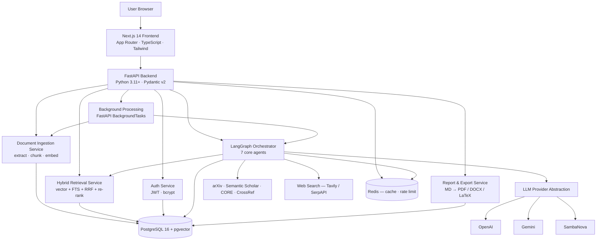

# Architecture — Aegis Research OS

Authoritative reference: [`design.md`](../design.md). This document is the Phase 0
deliverable: the high-level architecture at a glance, kept consistent with
[`db-schema.md`](./db-schema.md), [`agents.md`](./agents.md), and
[`api-contract.md`](./api-contract.md).

## Architectural style

A **modular monolith with an agentic core**. Two application services (Next.js
frontend, FastAPI backend) plus two infrastructure services (PostgreSQL with
pgvector, Redis). Inside the backend, boundaries are enforced by module structure
and typed service interfaces rather than network hops.

Four moving parts instead of eight is a deliberate constraint: pgvector replaces a
separate vector store, relational modelling defers a graph database, and FastAPI
`BackgroundTasks` defers a task queue.

## System context



## Layering

Dependencies point inward. Nothing below the API layer imports HTTP types.

```
api  →  services  →  repositories  →  core
```

| Layer | Package | Owns |
| --- | --- | --- |
| API | `app/api` | HTTP surface, validation, envelope, auth dependencies, project scope |
| Agents | `app/agents` | LangGraph graph, shared run state, tools, prompts |
| Services | `app/services` | Business logic: ingestion, retrieval, memory, reports, export |
| Repositories | `app/db/repositories` | Queries. The only place raw SQL — including vector and FTS — is written |
| Core | `app/core` | Config, security, LLM abstraction, cache, logging, errors, envelope |

## Delivered in Phase 0

| Component | State |
| --- | --- |
| Configuration (`app/core/config.py`) | Typed Pydantic settings; the single place environment variables are read |
| Structured logging (`app/core/logging.py`) | JSON logs, one event per line, `request_id`/`run_id` correlation |
| Error contract (`app/core/errors.py`) | Full exception hierarchy mapped centrally to HTTP status and envelope codes |
| Response envelope (`app/core/envelope.py`) | `{ success, data, error }` on every response, plus pagination |
| HTTP middleware (`app/core/middleware.py`) | Request correlation, access logging, security headers |
| Health endpoint (`app/api/health.py`) | Unauthenticated liveness probe at `/health` |
| Frontend shell | Root layout, semantic design tokens for both themes, typed API client |
| Infrastructure | Docker Compose (postgres · redis · backend · frontend), reverse proxy, CI |

Feature routers, database models, migrations, agents, and retrieval arrive in the
phases that own them; nothing is stubbed ahead of its phase.

## Communication

| From → To | Mechanism |
| --- | --- |
| Browser → Frontend | HTTPS, Next.js App Router |
| Frontend → Backend | REST/JSON, uniform envelope, `Authorization: Bearer` |
| Frontend ← Backend (answers) | Streaming response (SSE / chunked) |
| Frontend ← Backend (traces) | SSE stream of agent trace events |
| API → Services | In-process calls across typed interfaces |
| Orchestrator → Agents | LangGraph state transitions over a shared `AgentRunState` |
| Agents → LLM | `await provider.complete(...)` — cache-checked, tier-tagged, budget-bounded |
| Backend → PostgreSQL | SQLAlchemy 2.0 async, Alembic-managed schema |
| Backend → Redis | Async client: cache, rate limits, run status |

## Non-functional targets

| Target | Value |
| --- | --- |
| Simple RAG question, end to end | < 8 s |
| Multi-agent research request | < 2 min |
| External academic API response | < 5 s (p95) |
| Citation validity | 100% of citations resolve to a retrieved chunk |
| Cold-start reproducibility | Fresh clone + README → running stack, no undocumented steps |
