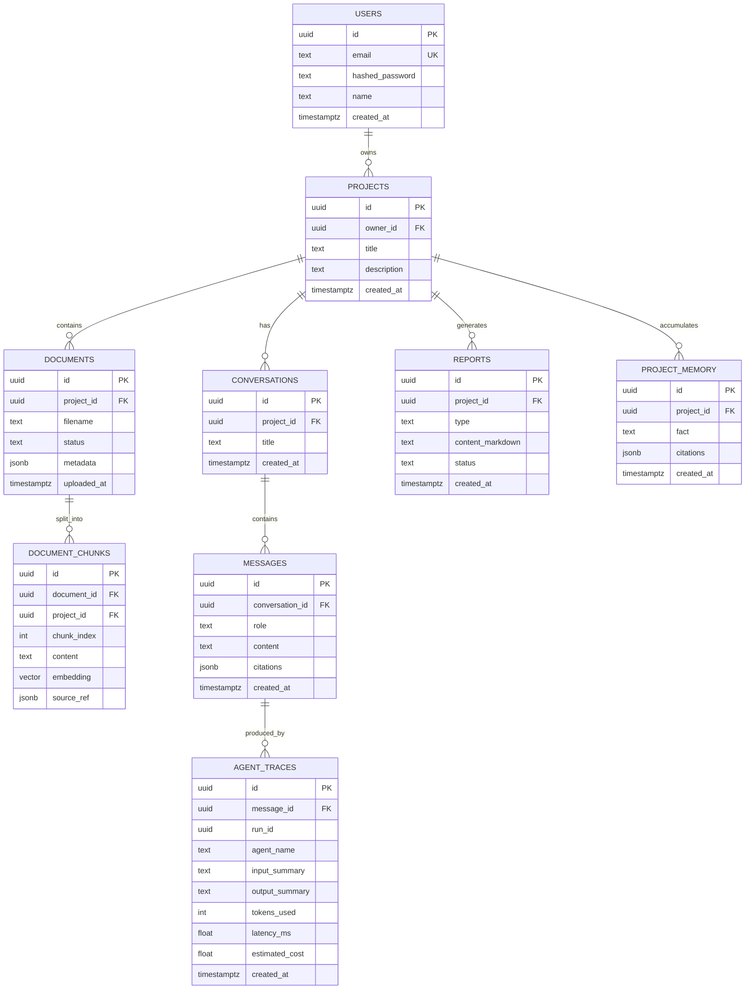

# Database Schema — Aegis Research OS

Authoritative reference: [`design.md` §7](../design.md). Table names here are the
names used in [`api-contract.md`](./api-contract.md) and [`agents.md`](./agents.md).

PostgreSQL 16 with the `pgvector` extension is the single store for relational
data, embeddings, and full-text search. Every schema change goes through an
Alembic migration; the initial migration enables the extension.

## Entity relationships (MVP)

## Tables

| Table | Phase | Purpose |
| --- | --- | --- |
| `users` | 1 | Identity and bcrypt credentials. `email` unique, stored lower-cased. |
| `projects` | 1 | Research workspace. The tenancy boundary for all content. |
| `documents` | 3 | One uploaded source file and its `pending`/`processing`/`ready`/`failed` state. |
| `document_chunks` | 3 | Retrieval unit: content, embedding, generated `tsvector`, and citation provenance. |
| `conversations` | 4 | Chat threads, project-scoped. |
| `messages` | 4 | Turns with `role`, Markdown content, and a structured `citations` array. |
| `agent_traces` | 5 | Per-agent step record: summaries, tokens, latency, estimated cost. |
| `project_memory` | 5 | Durable, source-backed facts distilled by the Memory agent. |
| `reports` | 6 | Generated artifacts; Markdown is the source of truth. |

Stretch tables — `graph_nodes`, `graph_edges` (Phase 7), `datasets` (Phase 8),
`project_members`, `activity_log` (Phase 10) — are added by the migration for the
phase that introduces them.

### Column notes

- **`document_chunks.project_id`** is denormalised from `documents` so the tenancy
  predicate applies inside the vector and FTS queries rather than after ranking.
- **`document_chunks.source_ref`** holds page number, section heading, and character
  offsets. Captured at chunk creation; it is what makes a citation verifiable.
- **`documents.metadata`** holds best-effort title/authors/page count plus the
  `ocr_used`, `ocr_low_confidence`, and `failure_reason` flags.
- **`agent_traces.run_id`** groups the steps of one run and is populated before the
  assistant message exists, so a live run is streamable.
- **`agent_traces`** stores *summaries*, never full payloads — a size and a privacy
  decision.

## Delete behaviour

Every content table reaches `projects` by foreign key with `ON DELETE CASCADE`, so
deleting a project removes its documents, chunks, conversations, messages, traces,
memory, and reports in one transaction.

## Indexing

| Table | Index | Serves |
| --- | --- | --- |
| `users` | unique (`email`) | Login lookup and uniqueness |
| `projects` | (`owner_id`, `created_at` DESC) | Dashboard listing |
| `documents` | (`project_id`, `uploaded_at` DESC) | Documents tab |
| `documents` | (`project_id`, `status`) partial on non-`ready` | Ingestion status polling |
| `document_chunks` | HNSW (`project_id`, `embedding`) cosine | Project-scoped semantic search |
| `document_chunks` | GIN on `tsvector(content)` | Keyword search |
| `document_chunks` | (`document_id`, `chunk_index`) | Ordered reconstruction, citation resolution |
| `messages` | (`conversation_id`, `created_at`) | Chat pagination |
| `agent_traces` | (`run_id`, `created_at`) | Trace panel, in order |
| `reports` | (`project_id`, `created_at` DESC) | Reports tab |

ANN indexes are approximate: the keyword path hedges recall loss, and the index is
built after bulk ingestion. Build parameters are recorded in the migration so
retrieval measurements stay reproducible.

## Multi-tenancy

Shared schema with row-level scoping; `project` is the boundary. Repository methods
touching project content require a `project_id` argument, so a cross-tenant query is
unwritable through the sanctioned API. Unauthorised access returns 404, never 403.
